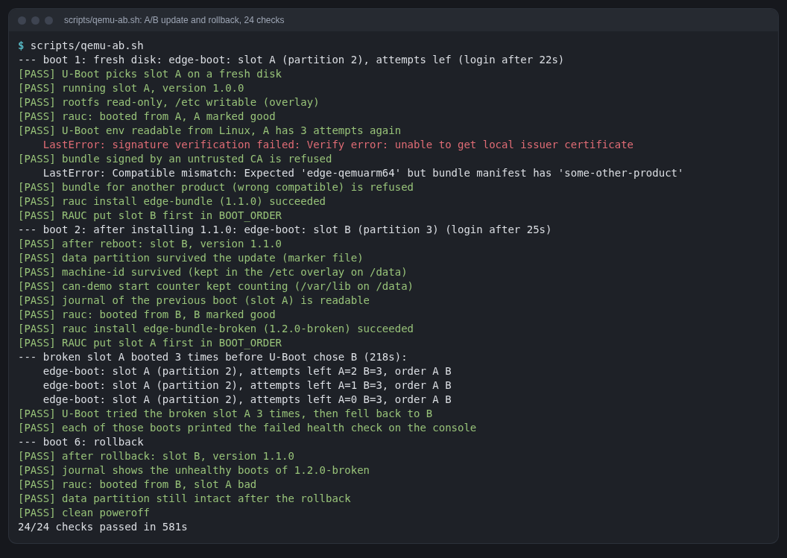
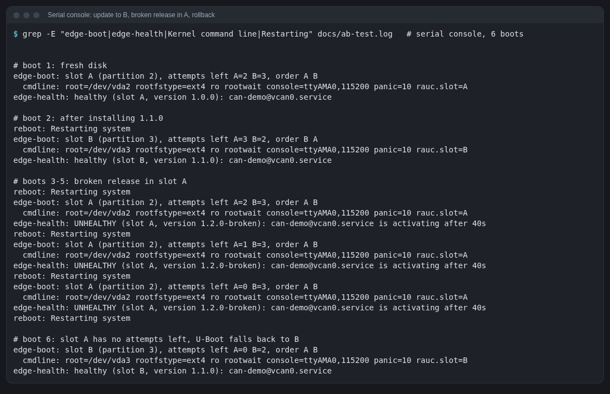

# edge-linux-can

A Yocto Project build of a small embedded Linux "edge" device that talks
SocketCAN, run entirely in QEMU on an x86 laptop. One custom layer adds a
Rust service built by Yocto, CAN interfaces brought up by systemd, a
hardware watchdog, a read-only root filesystem, and signed RAUC updates into
A/B slots, with U-Boot counting boot attempts and rolling back to the
previous release when a new one is unhealthy. Automated QEMU tests boot the
image, check all of that, and bridge the guest's CAN bus to the host.

This is a **learning and portfolio project**: everything is simulated (QEMU,
virtual CAN on the host), there is no real hardware and nothing here is
production-ready. The [learning guide](docs/learning-guide.md) explains each
concept as the project needed it, and the [build journal](docs/build-journal.md)
records every command, problem and fix.

Pairs with [zephyr-bms-can](https://github.com/dzulfikar08/zephyr-bms-can): a
fake battery management system on Zephyr RTOS, simulated in Renode, that
talks to this image's guest over the same host CAN bus.



## Architecture

```
 QEMU qemuarm64 (TCG, 4 vCPU, 256 MB)                                    host (x86 laptop)
 ┌──────────────────────────────────────────────────────────────┐
 │ U-Boot 2026.01: boot.scr picks slot A or B,                  │
 │   counts attempts (BOOT_ORDER, BOOT_A_LEFT, BOOT_B_LEFT)     │
 │                                                              │
 │ Linux 6.18 + systemd 259 (Poky 6.0.4)                        │
 │   rootfs A (ro) | rootfs B (ro) | /data (/etc, /var/lib      │
 │                                   overlays, journal, RAUC)   │
 │   rauc (signed verity bundles) ── edge-health ── mark good   │
 │   systemd ── i6300esb watchdog                               │
 │   can-demo@vcan0 ── vcan0  (heartbeat 0x100, stays inside)   │
 │   can-demo@can0  ── can0   (kvaser_pci, 500 kbit/s)          │
 └────────────────────────────┬─────────────────────────────────┘
          QEMU can-bus + can-host-socketcan
                              └──────────────────────────────►  vcan0  ◄── scripts/host-can.py (0x321)
                                                                  │   ──► scripts/can-watch.py (DBC decode)
                                                                  └──── zephyr-bms-can (Renode) on the same bus
```

## What's in the image

- **Yocto 6.0.4 "Wrynose"** (the current LTS), distro `poky`, `MACHINE = "qemuarm64"`, systemd 259
- Linux 6.18 (`linux-yocto`) with a config fragment for SocketCAN, vcan,
  the Kvaser PCI (SJA1000) and CTU CAN FD PCI drivers, and the i6300esb watchdog
- `can-utils`, `iproute2`
- **can-demo**: a Rust service (raw `CAN_RAW` sockets over `libc`) that sends
  a heartbeat frame every second and counts every frame it receives, logs
  to the journal, uses `sd_notify` READY/WATCHDOG, runs as a `DynamicUser`
  with no capabilities. One instance per interface (`can-demo@vcan0`,
  `can-demo@can0`)
- systemd units: `vcan@vcan0` creates a virtual CAN interface at boot;
  `can-bitrate@can0` sets 500 kbit/s and brings `can0` up when the
  controller appears
- systemd drives the hardware watchdog (`RuntimeWatchdogSec=30s`)
- **A/B updates**: U-Boot 2026.01 as firmware, a boot script that picks slot
  A or B and counts attempts (`BOOT_ORDER`, `BOOT_x_LEFT` in U-Boot's
  environment, shared with Linux via `fw_setenv`); **RAUC 1.15.2** with
  verity bundles signed by a development CA; a health check
  (`edge-health.service`) that lets the slot be marked good or reboots
- **Disk** (wic, GPT): boot (U-Boot script), rootfs A, rootfs B, data
- **Read-only root**: `/etc` and `/var/lib` are overlays on the data
  partition, `/var/log` (persistent journal) and RAUC's status live there too

## Layout

```
kas/qemuarm64.yml            layers, pinned commits, machine, local.conf settings
layers/meta-edge/            our layer
  conf/layer.conf
  recipes-core/images/edge-image.bb          the device image (+ edge-ab.wks disk layout)
  recipes-core/images/edge-image-update.bb   same image as release 1.1.0 (goes into the bundle)
  recipes-core/images/edge-image-broken.bb   a release whose can-demo fails (rollback test)
  recipes-core/bundles/                      RAUC bundle recipes
  recipes-core/rauc/                         system.conf (slots), keyring
  recipes-core/edge-system/                  data layout, persistent journal, health check
  recipes-core/volatile-binds/               /var/lib on the data partition
  recipes-core/edge-fault-inject/            the deliberate fault in edge-image-broken
  recipes-core/edge-watchdog/                systemd watchdog config
  recipes-bsp/u-boot/                        A/B boot script, fw_env.config
  recipes-kernel/linux/linux-yocto_%.bbappend + files/can.cfg, watchdog.cfg, mtd-flash.cfg
  recipes-connectivity/can-setup/            vcan@.service, can-bitrate@.service
  recipes-apps/can-demo/                     cargo recipe, crates.inc, unit, defaults
apps/can-demo/               the Rust service (source of the can-demo recipe)
scripts/kas                  kas-container wrapper: heavy dirs on the build disk
scripts/kas-container        kas-container 5.5 from siemens/kas
scripts/qemu-smoke.sh/.py    boot in QEMU, log in on the serial console, run checks
scripts/qemu-ab.sh/.py       A/B update and rollback test (6 boots, 24 checks)
scripts/edgeqemu.py          serial console driver used by both tests
scripts/forge-bundles.py     bundles the device must refuse (wrong signer, wrong compatible)
scripts/make-dev-keys.sh     development CA and signing key for bundles (keys/dev/, not committed)
scripts/host-can.py          host-side CAN peer for the smoke test
scripts/can-watch.py         live SocketCAN monitor with DBC decoding (stdlib only, + minidbc.py)
scripts/timed-build.sh       build with timing and disk usage logged
scripts/supervise-build.sh   rerun a build that a laptop sleep cancelled (+ build-sampler.sh)
scripts/term2png.py          terminal text → PNG for the docs
docs/                        learning guide, build journal, CAN bridge, next steps, images
```

## Build

Requirements: Docker (or Podman), ~60 GB free on the build disk, a few hours
for the first build. The host distro does not matter: kas-container builds
inside the official kas image (Debian 13).

```sh
scripts/make-dev-keys.sh                       # once: development signing keys in keys/dev/
# Where the heavy directories go (defaults shown):
export YOCTO_STORAGE=/mnt/yocto     # → work/, build/, downloads/, sstate/
scripts/kas build kas/qemuarm64.yml            # edge-image, edge-bundle, edge-bundle-broken
# or, detached and restarted if the laptop sleeps:
setsid nohup scripts/supervise-build.sh build7 >/dev/null 2>&1 &
```

The keys in `keys/dev/` are for development only and are not committed. A
clone without them fails at parse time with "run scripts/make-dev-keys.sh
first". Images built with one set of keys refuse bundles signed with
another (that is the point), so keep `keys/dev/` as long as you keep the
images.

Individual locations can be overridden with `KAS_WORK_DIR`, `KAS_BUILD_DIR`,
`DL_DIR`, `SSTATE_DIR`. An interactive shell with `bitbake` on the path:

```sh
scripts/kas shell kas/qemuarm64.yml
bitbake -e can-demo | grep ^S=           # inspect a variable
bitbake -c update_crates can-demo        # regenerate the crate list from Cargo.lock
```

## Boot and test in QEMU

```sh
scripts/qemu-smoke.sh                   # boots, runs checks, powers off; exit 0 = all passed
scripts/qemu-ab.sh                      # A/B update + rollback test, about 10 minutes
HOLD=600 scripts/qemu-smoke.sh          # keep the guest up 10 minutes after the checks
CAN_HOST=none scripts/qemu-smoke.sh     # don't bridge to the host
```

Interactive (inside `scripts/kas shell kas/qemuarm64.yml`):

```sh
runqemu qemuarm64 edge-image wic nographic slirp snapshot  # Ctrl-a x to quit; log in as root
```

Try an update by hand in that guest, the same steps `qemu-ab.py` runs (bundles are in the deploy directory;
serve it with `python3 -m http.server 8000` in a second `kas shell` started
with `--runtime-args "--network host"`):

```sh
rauc status
wget -O /data/b.raucb http://10.0.2.2:8000/edge-bundle-qemuarm64.raucb
rauc install /data/b.raucb && reboot
```

(With `snapshot` and without a flash file for U-Boot's environment, the
slot switch does not survive QEMU exiting; `scripts/qemu-ab.py` shows the
full command line with a persistent environment.)

### Bridge the guest's CAN bus to the host

Needs a `vcan0` on the host (root, once per boot):

```sh
sudo modprobe vcan && sudo ip link add dev vcan0 type vcan && sudo ip link set up vcan0
```

If it exists, `qemu-smoke.sh` gives the guest an emulated Kvaser PCI CAN card
on a QEMU CAN bus bridged to host `vcan0`, and starts the kas container with
`--network host` so QEMU can open it. The guest's `can-demo@can0` heartbeat
(id `0x101`) then shows up on host `vcan0`, and frames sent on host `vcan0`
reach guest `can0`. Watch it with any SocketCAN tool (DBC:
[`docs/can-demo.dbc`](docs/can-demo.dbc)), or:

```sh
scripts/can-watch.py vcan0 docs/can-demo.dbc --secs 10
```

## What was verified

All of this was run on 2026-11-10/11 in QEMU on one laptop, and is in the
logs and images under `docs/`.

### Base image (first stage)


| Check | Result |
|---|---|
| `kas build` of `edge-image` (5780 tasks) | succeeded, `do_kernel_configcheck` without warnings |
| Boot to login prompt (TCG, 4 vCPU, 256 MB) | 24–32 s |
| `systemctl is-system-running --wait` | `running`, no failed units |
| `vcan0` up, `vcan@vcan0` + `can-demo@vcan0` active | yes |
| `candump vcan0` | heartbeats `0x100` once per second |
| `can0` from `kvaser_pci`: UP, ERROR-ACTIVE, 500 kbit/s | yes |
| `can-bitrate@can0` + `can-demo@can0` active | yes |
| `candump can0` in the guest | own `0x101` and the host's `0x321` |
| Host `vcan0` receives guest heartbeats | 518 frames of `0x101` in one 9-minute run |
| systemd uses the i6300esb hardware watchdog | `RuntimeWatchdogUSec=30s`, watchdog active |
| can-demo statistics in the journal | yes, `heartbeat_missed=0` |
| A SocketCAN GUI analyzer on the host decodes the guest's frames with the DBC | yes (my own CAN analyzer tool, not part of this repo) |
| Clean poweroff | yes |

These checks still pass on the A/B image (15/15, with four new ones:
read-only root, `/data` overlays, RAUC status, health check + mark-good).
Serial console: [docs/first-boot.log](docs/first-boot.log); output:
[docs/images/smoke-test.png](docs/images/smoke-test.png).

### Read-only root and A/B updates (`scripts/qemu-ab.sh`, 24/24)

| Check | Result |
|---|---|
| Fresh disk: U-Boot boots slot A, release 1.0.0, rootfs `ro`, `/etc` writable via overlay | yes |
| `fw_printenv` in Linux reads U-Boot's environment; slot A marked good (`BOOT_A_LEFT=3`) | yes |
| Bundle signed by an untrusted CA | refused: `signature verification failed: … unable to get local issuer certificate` |
| Bundle with a valid signature but `compatible=some-other-product` | refused: `Compatible mismatch` |
| `rauc install` 1.1.0 → `BOOT_ORDER=B A`; after reboot slot B runs 1.1.0 | yes |
| Survived the update: marker file on `/data`, machine-id, can-demo's start counter, journal of the slot-A boot | yes |
| Broken release (can-demo fails) installed into A; A boots 3 times, health check fails each time, U-Boot then boots B | yes, 218 s from `reboot` to the fallback |
| After rollback: slot B, 1.1.0, healthy; `rauc status` shows A `bad`; data intact | yes |
| Data filesystem after 6 boots (3 forced reboots) | `dumpe2fs`: clean |



Log of all six boots: [docs/ab-test.log](docs/ab-test.log). Test output:
[docs/images/ab-test.png](docs/images/ab-test.png).

## What was not verified / not done

- No real hardware: everything ran in QEMU. The CAN controller is emulated
  and the "bus" is a host vcan, so bit timing, bus errors and bus-off were not exercised.
- The watchdog was armed and fed; a hang and reset were **not** provoked.
  So the "hang → watchdog reset → boot attempt used" path to rollback is
  designed but untested; only the "health check fails → reboot" path was
  exercised. A kernel panic (`panic=10`) was not provoked either.
- Bundles are downloaded to `/data` and then installed; RAUC's HTTP
  streaming install (no local copy) was not tried. There is no update
  server (hawkBit or similar) and no remote trigger.
- The keys are a development CA on the build host. No HSM, revocation or
  keyring rotation.
- U-Boot itself, its boot script and the boot partition are not updatable
  by bundles, and are not redundant. The boot script lives on a FAT
  partition (a corrupted one would stop the device booting); a product
  would build the logic into U-Boot's default environment.
- If both slots fail, the boot script resets both counters and tries
  again forever; there is no recovery/rescue system.
- `/data` is never checked with `fsck` (it is mounted by the init script
  before systemd); it is ext4 with a journal and was clean after the test.
- `ctucan_pci` (CAN FD) driver is built into the image but was not tested.
- The image is a development image: root logs in without a password.
- The app has unit tests on the host (`cargo test`, 8 tests); there is no
  on-target `ptest`.

## Build time and disk usage (this host: 12 cores, USB SSD build disk)

- Adding U-Boot, RAUC, wic and the bundles: **44 min** (kernel recompile
  22.5 min), then 22 min for fixes. A/B test run: about 10 min.
- First build from nothing: **about 5.5 hours** of build time over four
  runs (two of my own mistakes and a laptop sleep interrupted it; sstate
  kept all finished work). The largest single tasks: Rust toolchain 48 min,
  kernel 36 min, cargo 24 min. The Rust app itself: 1 min.
- Disk after the build: **~32 GB** (downloads 8.4 GB, sstate 4.9 GB,
  `build/tmp` 18 GB with `rm_work`). Peak during the build: 54 GB.
- Disk after the A/B stage: **~35 GB** (`build/tmp` 20 GB, downloads 8.7 GB, sstate 5.7 GB).
- Disk image (wic): 913 MiB; a slot image: 165 MiB ext4, 106 MB used;
  an update bundle: 38 MiB.

Details: [docs/build-journal.md](docs/build-journal.md).

## Documentation

- [docs/learning-guide.md](docs/learning-guide.md): Yocto concepts as this
  project needed them (layers, recipes, bbappend, kas, machine/distro/image,
  sstate, cargo recipes, kernel fragments, systemd units, runqemu, SocketCAN;
  part 2: wic, read-only rootfs, overlays, U-Boot environment and boot
  counting, RAUC slots/bundles/signing, health checks and rollback)
- [docs/build-journal.md](docs/build-journal.md): every command, problem and fix, with timings
- [docs/can-bridge.md](docs/can-bridge.md): guest CAN ⇄ host vcan0, watching it on the host
- [docs/next-steps.md](docs/next-steps.md): what is left (remote updates, recovery, real hardware, CAN FD)

## Pinned versions

| Component | Version / commit |
|---|---|
| bitbake | 2.18, `51fd94a6` (yocto-6.0.4) |
| openembedded-core | wrynose, `0f03c732` (yocto-6.0.4) |
| meta-yocto (meta-poky) | wrynose, `7c25b111` (yocto-6.0.4) |
| meta-openembedded (meta-oe) | wrynose, `c0fcd7cc` |
| meta-rauc | wrynose, `38da0e58` (RAUC 1.15.2) |
| U-Boot (from oe-core) | 2026.01, `qemu_arm64_defconfig` |
| kas / kas-container | 5.5 |
| Rust (from oe-core) | 1.94.1 |
| QEMU (built by Yocto) | 10.2.0 |

## License

MIT, see [LICENSE](LICENSE): the layer, recipes, scripts, the `can-demo`
application and the docs in this repository.

Third-party code is **not vendored**: bitbake, openembedded-core,
meta-yocto (poky), meta-openembedded, meta-rauc, and every upstream source
the build downloads (Linux, U-Boot, RAUC, systemd, Rust crates, ...) are
fetched at build time at the commits pinned in `kas/qemuarm64.yml` and stay
under their own licences. The one exception is `scripts/kas-container`,
copied unchanged from the [kas project](https://github.com/siemens/kas);
it keeps its own MIT licence header (Copyright Siemens AG).

The signing keys are generated locally by `scripts/make-dev-keys.sh` and are
not part of the repository.
