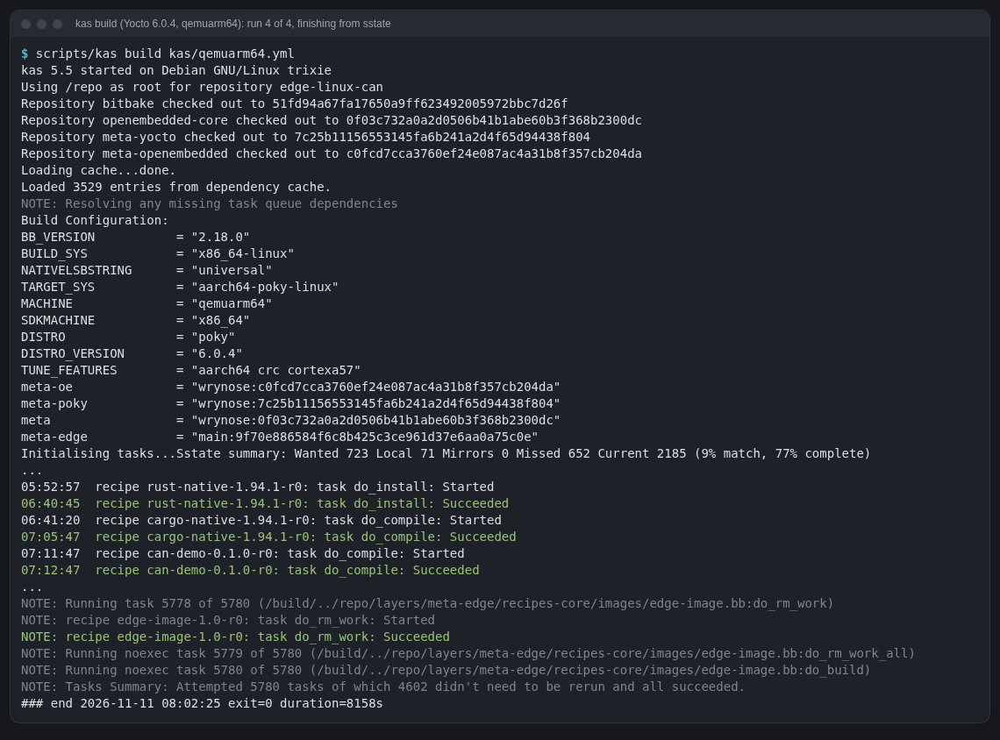
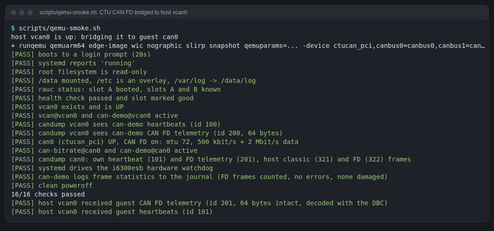
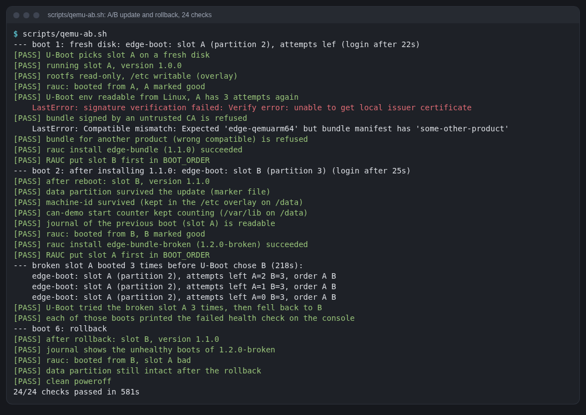
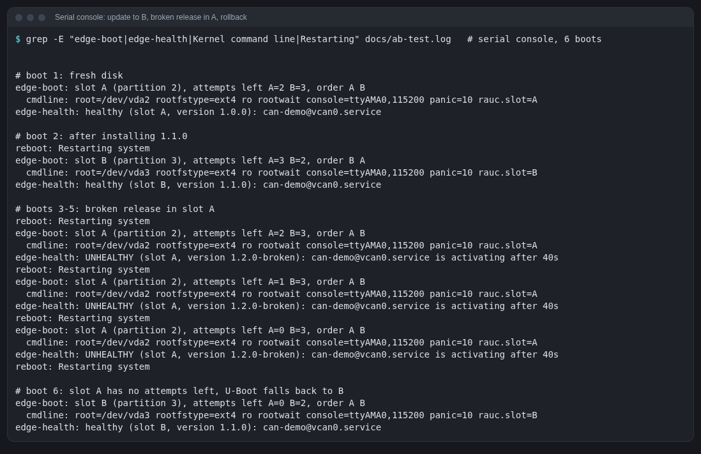
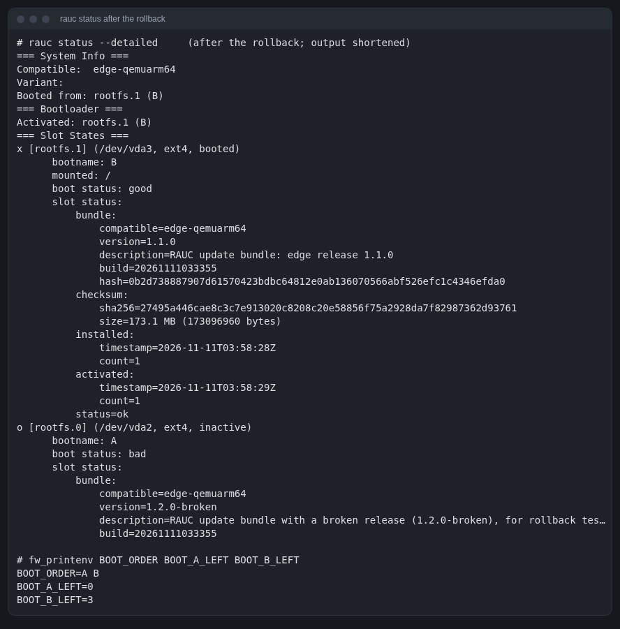
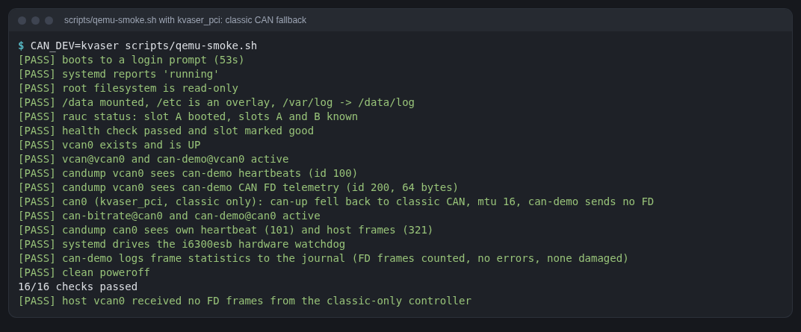
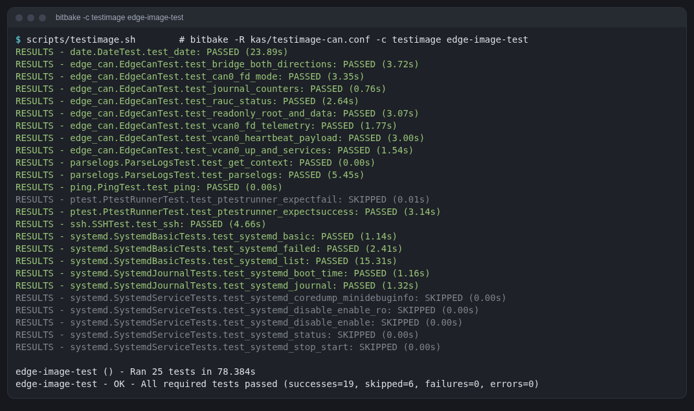

# Build journal

What was actually done, in order, between 2026-11-10 22:30 and 2026-11-11
08:35 (WIB), with the commands, the problems hit and how each was fixed. The
concepts behind each step are explained in [learning-guide.md](learning-guide.md).

Host: Arch Linux, 12 cores, 30 GB RAM, Docker 29.9. Build storage: an 84 GB
ext4 image on a USB SSD mounted at `/mnt/yocto`.

## 1. Choosing the release

```sh
git ls-remote --heads https://git.openembedded.org/openembedded-core   # scarthgap … whinlatter, wrynose
git ls-remote --tags  https://git.openembedded.org/openembedded-core 'yocto-6.0*'   # … yocto-6.0.4
git ls-remote --tags  https://git.openembedded.org/bitbake 'yocto-6.0.4*'
git ls-remote --tags  https://git.yoctoproject.org/meta-yocto 'yocto-6.0.4*'
git ls-remote https://git.openembedded.org/meta-openembedded refs/heads/wrynose
git ls-remote --tags https://github.com/siemens/kas            # newest: 5.5
```

Result: **Yocto 6.0.4 "Wrynose"** (LTS). The kas file pins bitbake,
openembedded-core and meta-yocto to the commits the `yocto-6.0.4` tags point
to, and meta-openembedded to the head of `wrynose` that day.

**Problem 1: bitbake's branch.** I first wrote `branch: "2.16"` for bitbake.
Checked before building:

```sh
git fetch https://git.openembedded.org/bitbake 2.18
git merge-base --is-ancestor 51fd94a6… FETCH_HEAD    # true: 6.0.4 is bitbake 2.18
```

The build log later confirms `BB_VERSION = "2.18.0"`.

**Problem 2: no poky repo for 6.0.** The combined `poky` repository has no
`wrynose` branch. bitbake, oe-core and meta-yocto are separate repos now; the
kas repo names `bitbake` and `openembedded-core` matter because
`oe-init-build-env` looks for `../bitbake` (seen in `scripts/oe-buildenv-internal`).

## 2. Tooling

```sh
curl -fsSL -o scripts/kas-container https://raw.githubusercontent.com/siemens/kas/5.5/kas-container
docker pull ghcr.io/siemens/kas/kas:5.5          # 1.75 GB, Debian 13 "trixie"
```

`scripts/kas` sets `KAS_WORK_DIR`, `KAS_BUILD_DIR`, `DL_DIR`, `SSTATE_DIR` to
the build disk and calls kas-container. Nothing heavy touches the internal disk.

## 3. The Rust app, tested on the host first

```sh
cd apps/can-demo
CARGO_TARGET_DIR=/tmp/can-demo-target cargo test      # 7 tests: frame layout, ids, config parsing, gap counting
CARGO_TARGET_DIR=/tmp/can-demo-target cargo clippy --all-targets
```

Once the host had a `vcan0` (created by hand with sudo; see
[can-bridge.md](can-bridge.md)), the app also ran natively against it, with
`scripts/host-can.py` as the peer:

```
can-demo 0.1.0 starting: iface=vcan0 heartbeat_id=0x101 interval=1000ms send=true listen=true
listener: first frame from id 0x101 len 8
listener: first frame from id 0x321 len 8
listener: frames total=10 errors=0 heartbeat_last_seq=3 heartbeat_missed=0 ids[0x101=4 0x321=6]
```

Bug caught in review before the first build: the watchdog helper computed
`Instant::now() - WATCHDOG_USEC/2`, which panics when the system has been up
for less than that (exactly the case right after boot). Replaced with an
`Option<Instant>` "never pinged yet".

## 4. First parse

```sh
scripts/kas shell kas/qemuarm64.yml -c 'bitbake -p && bitbake-layers show-layers'
# Parsing of 2005 .bb files complete (0 cached, 2005 parsed). 3528 targets, 119 skipped, 0 masked, 0 errors.
```

BitBake warned that the hash equivalence database sat inside the build dir
while `SSTATE_DIR` was shared; fixed with `BB_HASHSERVE_DB_DIR = "${SSTATE_DIR}"`.

## 5. Builds

Four runs of `scripts/timed-build.sh` (which wraps `scripts/kas build
kas/qemuarm64.yml` with timing and `du`). A sampler logged task number and
disk usage every 2 minutes.

| Run | Start | Wall time | Tasks | Result |
|---|---|---|---|---|
| 1 | 11-10 22:42 | 2 h 24 min | 3840 of 5761 | failed: taskhash mismatch (my mistake, below) |
| 2 | 11-11 01:07 | 2 min | (restored from sstate) | failed: `can-setup` packaging QA |
| 3 | 11-11 01:10 | ~51 min of work, then the laptop slept (power outage) for ~3 h 40 min | 4612 of 5780 | cancelled |
| 4 | 11-11 05:46 | 2 h 16 min | 5780 of 5780 | **succeeded** |

**Total build time from nothing to a bootable image: about 5.5 hours of
running builds** (sleep excluded), on this host with the build directory on
a USB SSD. A rerun with nothing changed would take minutes (everything comes
from sstate).

Where the time went (from the task timestamps of runs 3 and 4):

| Task | Duration |
|---|---|
| `rust-native` do_install (where `x.py` builds the compiler) | 48 min |
| `linux-yocto` do_compile | 36 min |
| `cargo-native` do_compile | 24 min |
| `libstd-rs` do_compile | 5 min |
| `can-demo` do_compile (our app) | 1 min |
| `git clone --mirror` of linux-yocto into `DL_DIR` | still running after 53 min when I looked (3.6 GB); runs in parallel with other tasks |



### Problem 3: "the metadata is not deterministic" (run 1)

```
ERROR: When reparsing …/linux-yocto_6.18.bb:do_fetch, the basehash value changed from 9dc23f… to 8ab5e5….
The metadata is not deterministic and this needs to be fixed.
ERROR: linux-yocto-6.18.52+git-r0 do_recipe_qa: Taskhash mismatch …
ERROR: can-demo-0.1.0-r0 do_recipe_qa: Taskhash mismatch …
```

Cause: **I edited the layer while the build was running.** I added the
watchdog fragment to the kernel `.bbappend` and a defaults file to the
can-demo recipe. kas mounts this repo live into the container, so when
BitBake re-parsed those recipes mid-build their signatures had changed.
Nothing was wrong with the metadata. Fix: none needed beyond restarting;
lesson: **don't touch layers during a build.** BitBake kept running the
already-scheduled independent tasks for two more hours (3840 tasks done),
all of which landed in sstate, so nothing was lost.

### Problem 4: `BB_DISKMON_DIRS` "ABORT" renamed (warning)

```
WARNING: The BB_DISKMON_DIRS "ABORT" action has been renamed to "HALT", update configuration
```

Fixed in the kas file. (Old tutorials still show `ABORT`.)

### Problem 5: `S` points to a missing directory (warning)

```
WARNING: can-setup-1.0-r0 do_unpack: … the directory ${UNPACKDIR}/${BP} … pointed to by the S variable doesn't exist
```

Recipes that only install loose files have no source tree. Fix:
`S = "${UNPACKDIR}"` in `can-setup` and `edge-watchdog`.

### Problem 6: template unit files not packaged (run 2)

```
ERROR: can-setup-1.0-r0 do_package: QA Issue: can-setup: Files/directories were installed but not shipped in any package:
  /usr/lib/systemd/system/vcan@.service
  /usr/lib/systemd/system/can-bitrate@.service
```

`SYSTEMD_SERVICE:${PN} = "vcan@vcan0.service"` enables the instance, but
reading `systemd.bbclass` shows why the template was left out: it finds the
directory via the template (`vcan@.service`) and then adds the *instance*
path (`vcan@vcan0.service`, which does not exist as a file) to `FILES`.
Fix: list the templates explicitly:

```bitbake
FILES:${PN} += "${systemd_system_unitdir}/vcan@.service ${systemd_system_unitdir}/can-bitrate@.service"
```

Same for `can-demo@.service`.

### Problem 7: the laptop slept (run 3)

A power outage put the laptop to sleep; kas logged `kas execution
cancelled` at task 4612. Restarted the same command; sstate skipped the
4602 tasks already done. A small supervisor script now restarts a build that
ends with "cancelled" (up to five times).

Other warnings in the logs were harmless: four upstream download servers
failed once (`quilt`, `gmp`, `ca-certificates`, `libsocketcan`) and the
fetcher fell back to the Yocto source mirror.

## 6. `update_crates`

```sh
scripts/kas shell kas/qemuarm64.yml -c 'bitbake -c update_crates can-demo'
```

Regenerated `can-demo-crates.inc` from `Cargo.lock`; the result was
byte-identical to the file I had written by hand from the lock file's
checksum (one crate: `libc 0.2.191`).

## 7. Booting and testing

Check first that the QEMU built by Yocto (10.2.0) has what we need:

```sh
scripts/kas shell kas/qemuarm64.yml -c \
  '/build/tmp/work/x86_64-linux/qemu-helper-native/1.0/recipe-sysroot-native/usr/bin/qemu-system-aarch64 -device help | grep -iE "kvaser|ctucan|i6300"'
# name "ctucan_pci", bus PCI, desc "CTU CAN PCI"
# name "kvaser_pci", bus PCI, desc "Kvaser PCICANx"
# name "i6300esb", bus PCI, desc "Intel 6300ESB"
# (and -object can-bus, can-host-socketcan)
```

(Calling the binary under `tmp/sysroots-components/` fails with a missing
`libepoxy.so.0`: that directory holds per-recipe pieces, not a complete
sysroot. runqemu uses the `qemu-helper-native` sysroot named in the image's
`qemuboot.conf`, which `rm_work` leaves alone.)

Then `scripts/qemu-smoke.sh`. It took five runs to get the test harness
right; the image itself did not change between them:

| Run | Result | What was wrong (in the test, not the image) |
|---|---|---|
| 1 | boot ok, 1/2 | runqemu refuses `.ext4.zst` without `snapshot` → added `snapshot`. Then the second shell command never echoed. |
| 2 | 1/2 | Answering the terminal's cursor-position query did not fix it. |
| (debug) | | A raw byte log with timestamps showed commands work when typed interactively, and that after login every line ends in `\r\r\n`. My marker regex accepted one `\r`. |
| 3 | 9/11 | `timeout` is not in core-image-minimal (BusyBox without that applet) → use `candump -n N -T ms` instead. |
| 4 | **11/11** | |
| 5 | **11/11**, `HOLD=420` | final run; its console is [first-boot.log](first-boot.log) |

Details worth knowing from this:
- The guest **asks the terminal for its size** (`ESC[6n`) twice: systemd
  259's getty and Poky's `/etc/profile` `resize` function, which turns echo
  off while it waits for the answer. A serial-console driver should answer
  like a terminal; the script replies `ESC[50;200R`.
- systemd 259 prints OSC 3008 "context" escape sequences around the prompt;
  prompt-matching regexes must allow escape sequences after `# `.

Boot to login prompt: **24–32 s** under TCG (x86 host emulating
Cortex-A57, 4 vCPUs, 256 MB). The rootfs is 221 MiB (34.6 MiB as
`.ext4.zst`), of which 100 MB is used; 110 packages.



## 8. Disk usage

| | Size |
|---|---|
| `downloads/` (DL_DIR) | 8.4 GB (3.6 GB of it the linux-yocto git mirror) |
| `sstate/` | 4.9 GB |
| `build/tmp/` | 18 GB (7.8 GB `work`, 2.8 GB `deploy`, 1.6 GB `sysroots-components`) |
| `work/` (layer checkouts) | 0.4 GB |
| **Total** | **~32 GB** after the build; **peak 54 GB used** during run 4 |

Peak `tmp/` was 42 GB: `rm_work` only deletes a recipe's work dir after that
recipe finishes, and big recipes (rust, kernel, gcc) are large while they
build. Free space never dropped below 26 GB, so the 10 GB guard never fired.

## 9. Host side: watching the bus

See [can-bridge.md](can-bridge.md). One extra problem with a host-side Rust
tool: its build vanished a few hours later. A cargo wrapper on this host
replaced `target/` with a symlink into a cache on the internal disk, and the
cache was evicted. Rebuilt with an explicit `CARGO_TARGET_DIR` on the build
disk.

---

# Part 2: read-only root and A/B updates

2026-11-11, 09:05–11:15 (WIB). Goal from [next-steps.md](next-steps.md):
read-only rootfs, RAUC A/B updates with rollback, tested in QEMU. Concepts:
[learning-guide.md chapters 15–21](learning-guide.md#part-2-read-only-root-and-ab-updates).

## 10. Research before writing anything

```sh
git ls-remote --heads https://github.com/rauc/meta-rauc            # wrynose: 38da0e58
git ls-remote --heads https://github.com/rauc/meta-rauc-community  # master, scarthgap only: no wrynose
git clone -b wrynose https://github.com/rauc/meta-rauc /tmp/rauc-ref/meta-rauc
git clone https://github.com/rauc/meta-rauc-community /tmp/rauc-ref/meta-rauc-community
```

meta-rauc-community has no wrynose branch, so it is **not** a layer here;
its `meta-rauc-qemuarm` was read as a reference (U-Boot boot script, flash
environment, `fw_env.config`). Read in oe-core: `overlayfs-etc.bbclass` and
its init template, `volatile-binds`, `read_only_rootfs_hook`, `u-boot.inc`
(`UBOOT_ENV`), `image_types_wic.bbclass`, and runqemu's drive handling.
Things found by reading, each of which would have cost a build otherwise:

| Found | Consequence |
|---|---|
| `overlayfs-etc`'s init script runs `mount -o remount,rw /` unless `OVERLAYFS_ETC_CREATE_MOUNT_DIRS = "0"` | the root would have been writable while looking read-only; set to 0 and create `/data` at build time |
| wic left oe-core in 6.0 (`wic-native`, git.yoctoproject.org/wic 0.3.1); plugin names use underscores (`bootimg_partition`) | checked the plugin list in the downloaded wic source |
| `WKS_FILE_DEPENDS_BOOTLOADERS:aarch64 = "grub-efi systemd-boot"` | two bootloaders built for nothing; set to `""` |
| runqemu attaches wic disks as virtio-**scsi** on qemuarm64 (`QB_DRIVE_TYPE = "/dev/sd"`) | the guest would see `/dev/sda`, not `/dev/vda`; `QB_DRIVE_TYPE = "/dev/vd"` |
| U-Boot 2026.01 `qemu_arm64_defconfig`: `CONFIG_ENV_IS_IN_FLASH`, `ENV_ADDR=0x4000000`, `ENV_SIZE=0x40000` | `fw_env.config`: `/dev/mtd0 0x4000000 0x40000 0x40000` (checked with `bitbake -c unpack u-boot`) |
| journald stores logs per machine id; an empty `/etc/machine-id` on a read-only `/etc` gives a new id every boot | `/etc` overlay on `/data` keeps the id, so old boots stay readable |
| `VOLATILE_LOG_DIR` is gone in 6.0 (`/var/log` → `volatile/log` is a `FILESYSTEM_PERMS_TABLES` choice that changes systemd's recipe) | replace the symlink in the image instead (`/var/log` → `/data/log`): no package rebuilds |
| systemd-conf ships `80-wired.network` (DHCP) | the guest still gets an address under slirp now that runqemu's `ip=dhcp` kernel argument is gone (U-Boot owns the command line) |

## 11. Keys, layer, tests

```sh
scripts/make-dev-keys.sh        # keys/dev/: dev CA, signing cert/key, other-ca/ (git-ignored)
scripts/kas shell kas/qemuarm64.yml -c 'bitbake -p'
# Parsing of 2024 .bb files complete (0 cached, 2024 parsed). 3549 targets, 119 skipped, 0 masked, 0 errors.
```

What was added is listed in the commit "Read-only rootfs and RAUC A/B
updates with U-Boot boot counting". The can-demo app gained a persistent
start counter (`StateDirectory=can-demo`), host tests: 8 pass.

## 12. Builds

| Run | Start | Wall time | Tasks run (of 6498) | Result |
|---|---|---|---|---|
| 5 | 09:34 | 44 min (2617 s) | 941 | **succeeded first time**; 1 warning (below) |
| 6 | 10:33 | 22 min (1320 s) | 148 | succeeded, no warnings (fixes after the first test run) |

Run with `setsid nohup scripts/supervise-build.sh build5 &` (restarts a
build that a laptop sleep cancels; now in the repo instead of only on the
build disk). New compile work in run 5: kernel 22.5 min (MTD and RAUC
fragments changed its config), U-Boot 2 min, U-Boot tools 2 min, RAUC and
rauc-native < 1 min each; the rest is images, bundles and many small
native tools wic needs. The second kernel compile (run 6) took 11 min.

Warning in run 5:

```
WARNING: linux-yocto-6.18.52+git-r0 do_kernel_configcheck: [kernel config]: This BSP contains fragments with warnings:
  the following symbols were not found in the active configuration: CONFIG_MTD_CHAR
```

`CONFIG_MTD_CHAR` no longer exists in Linux 6.18 (the MTD character device
is always built); the line was removed from `mtd-flash.cfg`.

Outputs (deploy directory):

| File | Size |
|---|---|
| `edge-image-qemuarm64.rootfs.wic` (whole disk) | 913 MiB (sparse) |
| `edge-image*-qemuarm64.rootfs.ext4` (one slot image) | 165 MiB, 106 MB used, `IMAGE_ROOTFS_EXTRA_SPACE = "0"` |
| `edge-bundle-qemuarm64.raucb` | 38 MiB (squashfs-compressed ext4 + verity tree + signature) |
| `edge-bundle-broken-qemuarm64.raucb` | 38 MiB |

Disk on the build volume afterwards: `build/tmp` 20 GB, `downloads` 8.7 GB,
`sstate` 5.7 GB, `work` 0.4 GB: this project ~35 GB, 40 GB free (the
volume also holds 3.2 GB of another project). Free space never dropped
below 40 GB during these builds, far from the 10 GB guard.

## 13. Testing

### Smoke test: passed first time

`scripts/qemu-smoke.sh` now boots the wic disk through U-Boot (runqemu reads
`QB_DEFAULT_BIOS`, `QB_DEFAULT_FSTYPE`, `QB_DRIVE_TYPE` from the image's
`qemuboot.conf`) and has four new checks (read-only root, `/data` overlays,
RAUC status, health check + mark-good). 15/15 with the CAN bridge on the
first run and again on the final build; host `vcan0` received the guest's
`0x101` heartbeats (97 and 73 frames). Boot to login: 37 s, and 92 s on the
final run while another project's Rust build loaded the host (load
average 20 on 12 cores); the A/B runs booted in 22–33 s.

The console showed the boot path working as designed:

```
edge-boot: slot A (partition 2), attempts left A=2 B=3, order A B
Kernel command line: root=/dev/vda2 rootfstype=ext4 ro rootwait console=ttyAMA0,115200 panic=10 rauc.slot=A
EXT4-fs (vda2): mounted filesystem … ro with ordered data mode.
PREINIT: Start
EXT4-fs (vda4): mounted filesystem … r/w with ordered data mode.
PREINIT: done; starting </sbin/init>
…
touch: /usr/test-write: Read-only file system
/data/overlay-etc/upper /etc overlay rw,…,lowerdir=/etc,upperdir=/data/overlay-etc/upper,…
overlay /var/lib overlay rw,…,lowerdir=/var/lib,upperdir=/data/var-lib,…
```

### A/B test, run 1: 18/23, every failure in the test

`scripts/qemu-ab.sh` on build 5. The update, the reboot into B, the
three failed boots of the broken release and the fallback all worked. The
five failures:

| Failure | Cause | Fix |
|---|---|---|
| "booted from A, A marked good" and "slot A bad" | `rauc status` colours its output; `boot status: good` was really `boot status: \e[32mgood\e[0m` | the console driver strips escape sequences from command output |
| journal of the previous boot | `tail -n 1` picked systemd's "Stopped Health check…" line, not the script's verdict | `grep '^edge-health:'` |
| failed health check on the console | after boot, systemd stops printing unit status on the console, so the failure was only in the journal | `StandardOutput=journal+console` in `edge-health.service` (a real device should say on its console why it reboots) |
| foreign-signed bundle | `rauc resign` must mount the bundle (loop device, root), impossible in the unprivileged kas container: `cannot check bundle payload without exclusive access: unable to find mounted device for bundle` | `scripts/forge-bundles.py`: a bundle ends in `[CMS signature][size]`; the CMS contains the manifest. openssl re-signs it with the other CA, and also makes a second bundle with `compatible=some-other-product` signed with *our* key |

Also fixed: the boot script printed `order ${BOOT_ORDER}` literally:
U-Boot's hush shell treated the `'…'` inside a double-quoted `echo` as
quotes and did not expand the variable.

The shutdown log also showed `[FAILED] Failed unmounting /data.` That is
expected (the `/etc` overlay still uses `/data`), and the end of the
shutdown, visible during the unmonitored reboots, shows systemd's final
stage cleaning up:

```
(sd-remount)[496]: Remounting '/data' read-only with options ''.
EXT4-fs (vda4): re-mounted 774f8ab7-… ro.
(sd-umount)[497]: Unmounting '/data'.
systemd-shutdown[1]: All filesystems unmounted.
```

After the final run, `dumpe2fs -h` on the data partition of the test disk
says `Filesystem state: clean`, `Mount count: 6` (six boots, three of them
forced reboots).

### A/B test, run 2 (build 6): 24/24 in 581 s



The serial console of the six boots ([ab-test.log](ab-test.log), excerpt
in [captures/ab-console.txt](captures/ab-console.txt)):



The refusals, from `rauc install`:

```
LastError: signature verification failed: Verify error: unable to get local issuer certificate
LastError: Compatible mismatch: Expected 'edge-qemuarm64' but bundle manifest has 'some-other-product'
```

After the rollback ([captures/rauc-status-rollback.txt](captures/rauc-status-rollback.txt)):



Timings inside the test (TCG, 4 vCPU, 512 MB): boot to login 22–33 s;
`rauc install` of a 38 MiB bundle from `/data` about 10 s (signature check at 03:58:18, slot written and activated at 03:58:28 in the log); each failed boot
of the broken release about 70 s (boot, 40 s health timeout, reboot), so the
rollback took 218 s from `reboot` to U-Boot choosing B.

---

# Part 3: tests, SBOM and CVEs, CAN FD

2026-11-11, from 11:40 (WIB). Goals from [next-steps.md](next-steps.md),
sections 3 and 4: ptest for can-demo, oe-core's testimage with our own CAN
test case, SBOM and CVE report, can-demo pinned by git `SRCREV`, CAN FD.
Concepts: [learning-guide.md chapters 22–26](learning-guide.md#part-3-tests-in-the-image-sbom-and-cves-pinned-sources-can-fd).

## 14. Research before writing anything

Read in the checked-out layers (`$YOCTO_STORAGE/work/`), each one a
decision:

| Found | Consequence |
|---|---|
| `meta/classes*/` has `ptest-cargo.bbclass`; it runs `cargo build --tests --message-format json` and parses the JSON for the test binaries, one `PASS:`/`FAIL:` per binary | `inherit ptest-cargo` replaces `inherit cargo`; can-demo's 13 Rust tests are one ptest result |
| `poky` gets `ptest` in `DISTRO_FEATURES` from oe-core's defaults (`bitbake-getvar --value DISTRO_FEATURES`) | no distro change, so no rebuild of everything; `can-demo-ptest` is produced automatically |
| **No `cve-check.bbclass`** in this release, only `sbom-cve-check*.bbclass`, the recipe `python3-sbom-cve-check` 1.3.5 and two database recipes, and the fragment `conf/fragments/yocto/sbom-cve-check.conf` | use sbom-cve-check; it scans the image's SPDX 3.0 SBOM, so `create-spdx` (already on by default) is a prerequisite |
| The fragment sets the database recipes' `SRCREV` to `AUTOREV`; the databases are the GitHub repos `fkie-cad/nvd-json-data-feeds` (4.5 GB) and `CVEProject/cvelistV5` (3.4 GB) | pin both to the heads of 2026-11-11 04:55 UTC and fetch them with `BB_GIT_SHALLOW = "1"` (one commit; bitbake's "fast shallow clone" runs `git fetch --depth 1` directly against the server) |
| `SPDX_INCLUDE_COMPILED_SOURCES:pn-linux-yocto = "1"` in the fragment; `spdx-common.bbclass` turns it into `SPDX_INCLUDE_SOURCES` | lets the scanner drop kernel CVEs in files that are not compiled; costs a rerun of the kernel's SPDX task |
| `testimage.bbclass`: `TEST_RUNQEMUPARAMS` containing `slirp` makes oeqa read the forwarded ssh port from QEMU's command line (`hostfwd=tcp:...`) | testimage without tap devices, so without sudo |
| testimage refuses to run unless `IMAGE_FEATURES` has `allow-empty-password empty-root-password allow-root-login` | already set for this development build |
| oeqa's `ping` case skips when the target address is `127.0.0.x` (slirp); `df` skips on a read-only rootfs; `scp` needs `openssh-scp` | `TEST_SUITES = "ping ssh date systemd ptest parselogs edge_can"` |
| testimage reads `TEST_QEMUPARAMS` from the datastore at test time, and `write_image_test_data` only depends on the variables it uses | a `bitbake -R kas/testimage-can.conf` override for the CAN bridge does not change any image's task hash |
| Runtime test cases are found in `<layer>/lib/oeqa/runtime/cases/` for every layer in `BBLAYERS` | `layers/meta-edge/lib/oeqa/runtime/cases/edge_can.py` |
| bitbake's git fetcher: `subpath=apps/can-demo` unpacks into `${UNPACKDIR}/can-demo` | `S` stays the same |
| QEMU 10.2 (Yocto's): `-device ctucan_pci,help` lists `canbus0` and `canbus1`; `kvaser_pci` had `canbus` | `-device ctucan_pci,canbus0=canbus0` |
| Host `vcan0` MTU is 2060 (CAN XL); the kernel's `raw_check_txframe` accepts FD frames on CAN XL MTU devices | the host side carries FD as is |
| zephyr-bms-can's `tools/edge_demo.py` boots its **own copy** of an older edge image (`$ZBMS_STORAGE/edge-image`, kernel + ext4, `kvaser_pci`) | this change cannot break the demo directly; it still has to work with a `kvaser_pci` (classic) controller later, hence the classic fallback in `can-up` |

## 15. The app first, on the host

```sh
cd apps/can-demo
CARGO_TARGET_DIR=/tmp/can-demo-target cargo test     # 13 passed (was 8)
CARGO_TARGET_DIR=/tmp/can-demo-target cargo clippy --all-targets   # clean
```

One of the new tests opens two real sockets on host `vcan0` and sends a
classic and an FD frame through the kernel. Then the binary against host
`vcan0`, with the new `scripts/host-can.py` as the peer (the host has no
can-utils, so the host side is stdlib Python):

```
can-demo 0.1.0 starting: iface=vcan0 heartbeat_id=0x101 fd=Auto fd_id=0x201 interval=1000ms send=true listen=true
sender: CAN FD telemetry on vcan0 with id 0x201
listener: first frame from id 0x201 len 64 (FD+BRS)
listener: first frame from id 0x101 len 8 (classic)
listener: first frame from id 0x321 len 8 (classic)
listener: first frame from id 0x322 len 64 (FD+BRS)
listener: frames total=16 errors=0 fd=7 fd_bad=0 heartbeat_last_seq=2 heartbeat_missed=0 ids[0x101=3 0x201=4 0x321=6 0x322=3]
```

and `host-can.py` decoded the guest-to-be's FD frame with the DBC:

```json
{"message": "EdgeTelemetryFd", "signals": {"Seq": 3, "Magic": 827606086, "UptimeMs": 3000,
 "FramesRx": 15, "StartCount": 0, "PatternFirst": 3, "PatternLast": 34}}
```

(`827606086` is `0x31544446`, "FDT1" read as a little-endian u32.)

The app was committed first, because the recipe's `SRCREV` has to name an
existing commit. (In my working copy, where this journal's builds ran, the
recipe fetched from a local clone, `git://${EDGE_REPO_DIR};protocol=file`,
and the app commit was `4ba7504`; the commit ids and `git+file:///repo`
locations below are from there. In this repository the recipe fetches the
same source from GitHub at `da2515c`.)

## 16. Parse check

```sh
scripts/kas shell kas/qemuarm64.yml -c '
  bitbake -p
  bitbake-getvar --value DISTRO_FEATURES | tr " " "\n" | grep -x ptest
  bitbake-getvar -r can-demo --value SRC_URI
  bitbake -c unpack can-demo'
# Parsing of 2025 .bb files complete (0 cached, 2025 parsed). 3550 targets, 119 skipped, 0 masked, 0 errors.
# ptest
# git:///repo;protocol=file;branch=main;subpath=apps/can-demo  file://can-demo@.service ...
# can-demo: do_unpack Succeeded; sources/can-demo has Cargo.lock Cargo.toml LICENSE src
```

## 17. Build (run 7)

```sh
setsid nohup scripts/supervise-build.sh build7 >/dev/null 2>&1 &
```

| Run | Start | Wall time | Tasks run (of 6779) | Result |
|---|---|---|---|---|
| 7 | 12:00 | **67 min** (4007 s) | 2938 (3841 from sstate or current) | succeeded; 82 warnings, 81 of them sbom-cve-check's "Found unpatched CVEs" lines |

No laptop sleep this time, so the supervisor did not have to restart it.
Where the time went (task time; up to 8 tasks run in parallel):

| Task(s) | Time |
|---|---|
| `do_create_spdx`, all recipes (rerun because `SPDX_INCLUDE_VEX` changed every recipe's SPDX task) | 124 min in total; the kernel's alone 14 min |
| `do_unpack` of recipes whose SPDX now includes source data (rust 9 min, libstd-rs 8, cargo 8, ...) | 61 min in total |
| `do_sbom_cve_check`, four images | 14 min each, in parallel |
| fetch of the two CVE databases (shallow) | 9 min (cvelistV5) and 8 min (NVD) |
| can-demo (`do_compile` + `do_compile_ptest_cargo`) | about 1 min |

The kernel was **not** recompiled: its SPDX task reran from the sources in
`work-shared`. The only non-CVE warning was a download mirror fallback
(`openssh-10.3p1`: the OpenBSD server failed once; `openssh-sftp-server`
comes with `packagegroup-core-ssh-dropbear` in the test image).

Outputs worth knowing:

| File (deploy dir) | Size |
|---|---|
| `edge-image-qemuarm64.rootfs.spdx.json` (SBOM) | 46 MB |
| `…rootfs.sbom-cve-check.spdx.json` (SBOM + CVE results) | 131 MB |
| `…rootfs.sbom-cve-check.yocto.json` (cve-check format) | 35 MB |
| `edge-image-test-qemuarm64.rootfs.wic` | same layout as edge-image |
| `rootfs.manifest`: `can-demo cortexa57 0.1.0+git0+4ba7504bea` | the app commit, as intended |

Disk: the CVE databases came as two shallow tarballs (339 MB + 467 MB in
`downloads/`) but are **unpacked to 8.8 GB** in
`tmp/deploy/sbom-cve-check/databases` (the recipes exclude themselves from
`rm_work`). `build/` grew from 20 to 31 GB. Free space on the build disk:
39 GB before, never below 28 GB during the build (the 10 GB guard never
came close), 28 GB after.

## 18. Smoke test: three problems, all in the test or the emulator

| Run | Result | Problem | Fix |
|---|---|---|---|
| 9 | QEMU did not start | `qemu-system-aarch64: -device ctucan_pci,canbus0=canbus0: ctucan_connect_to_bus failed`. The CTU CAN FD PCI card has two controllers and QEMU wants a bus for each | a second, empty `can-bus` for `canbus1` |
| 10 | 15/16 | can0 is in FD mode, frames flow both ways, but `ip -details` says `can <FD> state STOPPED`, not `ERROR-ACTIVE` | see below |
| 11 | **16/16** + host checks | | |
| 12 (`CAN_DEV=kvaser`) | 15/16 | the statistics check read the *last* journal line, which was can0's: `fd=0` is right on a classic controller | check that some instance counted FD frames and none had errors or damaged frames |
| 13 (kvaser), 14 (ctucan) | **16/16** each, host checks 2/2 each | | |

The `STOPPED` state, read in the sources rather than guessed at:

```c
/* linux drivers/net/can/ctucanfd/ctucanfd_base.c, ctucan_chip_start() */
/* Controller enters ERROR_ACTIVE on initial FCSI */
priv->can.state = CAN_STATE_STOPPED;
```

```sh
tar -xJOf downloads/qemu-10.2.0.tar.xz '*/hw/net/can/ctucan_core.c' | grep -n 'int_stat.s.'
# 278: int_stat.s.txi = 1;  279: int_stat.s.txbhci = 1;  551: int_stat.s.doi = 1;
# 559: int_stat.s.rxi = 1;  561: int_stat.s.rxfi = 1;      (no fcsi anywhere)
```

QEMU's model never raises the fault-confinement-state interrupt, so the
driver never leaves `STOPPED`. On hardware it would. The tests now accept
`STOPPED` for this controller and rely on the traffic checks.

Final smoke runs (boot to login 28–78 s; the host was also running other
work, load average around 18):




What the host received in one run (run 14): 106 classic heartbeats `0x101`
and 106 FD telemetry frames `0x201`, all 106 with intact patterns and the
BRS flag; the guest received the host's `0x321` and `0x322` (FD, 64 bytes).
Captures: [guest-canfd.txt](captures/guest-canfd.txt),
[host-canfd.txt](captures/host-canfd.txt). With `kvaser_pci` the journal
shows the fallback:

```
can-up: can0: controller refused CAN FD, using classic CAN
can-up: can0: classic CAN, bitrate 500000
sender: can0 is classic CAN only (or --fd off): heartbeat only
```

## 19. testimage

```sh
scripts/testimage.sh     # bitbake -R /repo/kas/testimage-can.conf -c testimage edge-image-test
```

| Run | Time | Result | Problems (all in `edge_can.py`) |
|---|---|---|---|
| 1 | 4 min 50 s | 25 tests: 13 passed, 9 skipped, 3 failed | `/etc/rauc/system.conf` does not exist (meta-rauc installs it in `/usr/lib/rauc/`); a `^…` regex over `/proc/mounts` without `re.M`; the guest's `vcan0` has MTU **2060**, not 72 (Linux 6.18 creates vcan with the CAN XL MTU). Three tests depending on the vcan0 one were skipped |
| 2 | about 5 min | **19 passed, 6 skipped, 0 failed** | |

Every oe-core case passed first time, including `systemd.test_systemd_failed`
(no failed units on the read-only image) and `parselogs` (no unexpected
errors in the logs). The ptest case ran `ptest-runner -t 450` on the target:
13 Rust tests, `PASS: /usr/lib/can-demo/ptest/can_demo-1a570fc8e0467e34`.



## 20. A/B test

`scripts/qemu-ab.sh` on the new images: **24/24 in 653 s** (581 s before;
the host was busier). The A/B test does not use CAN, and nothing it checks
changed; it is the regression check that the update and rollback path still
works with the new can-demo (the health check waits for `can-demo@vcan0`).

## 21. CVE report

```sh
scripts/cve-summary.py $DEPLOY/edge-image-qemuarm64.rootfs.sbom-cve-check.yocto.json \
    --manifest $DEPLOY/edge-image-qemuarm64.rootfs.manifest --pkgdata build/tmp/pkgdata/qemuarm64 \
    > docs/cve/edge-image-summary.md
```

| | All 106 recipes in the SBOM | 64 installed recipes |
|---|---|---|
| Unpatched | 735 | 703 |
| Patched | 21,861 | 21,217 |
| Ignored | 1,258 | 1,258 |

Unpatched by recipe: linux-yocto 594 (581 of them 2026 CVEs in range,
13 old ones without version ranges), curl 29, openssl 19, python3 18 (build
only), glibc 14, expat 12, sqlite3 11 (build only), libpcre2 8, u-boot 8,
busybox 4, libx11 4. Full list: [cve/edge-image-summary.md](cve/edge-image-summary.md);
how to read it: [learning guide, chapter 24](learning-guide.md#the-report-for-this-image).
Nothing was fixed in this stage.

Two things the report showed that I would not have guessed:

- **libx11 is installed** in this headless image. `pkgdata` says why:
  `RDEPENDS:dbus: ... libx11 (>= 1.8.13)` (Poky has `x11` in
  `DISTRO_FEATURES`, so dbus builds `dbus-launch` with X11 support). It was
  there in the first build already.
- The image SBOM also covers recipes that were only **built**, not
  installed (python3, sqlite3, wayland, ...), so the raw numbers overstate
  what is on the device; the script separates the two.

The SBOM records the app commit as intended:

```json
{"type": "software_Package", "name": "repo", "software_primaryPurpose": "source",
 "software_downloadLocation": "git+file:///repo@4ba7504bea247647ed1ac48961706860513a1014",
 "software_packageVersion": "4ba7504bea247647ed1ac48961706860513a1014"}
```

(With the recipe in this repository it is the GitHub URL at `da2515c`.)

## 22. Does the Zephyr BMS project still work?

The separate [zephyr-bms-can](https://github.com/dzulfikar08/zephyr-bms-can) project shares host `vcan0` (ids 0x410–0x430,
classic CAN) and its edge demo boots a copy of this image.

| Run | Result |
|---|---|
| `scripts/test.sh` (BMS in Renode, host side over vcan0) | **36/36** in 70 s |
| `. scripts/env.sh && tools/edge_demo.py` | **13/13** in 138 s |
| BMS test while this project's new guest sent CAN FD frames on the same vcan0 (`HOLD=150 scripts/qemu-smoke.sh` in parallel) | **36/36** in 76 s; the guest's smoke checks passed alongside |

The edge demo boots its **own copy** of an older edge image (kernel + ext4,
`kvaser_pci`), copied before this stage, so it does not exercise the new
image; nothing in zephyr-bms-can was changed. The parallel run is what shows
that FD traffic on the shared bus does not disturb the BMS side. The BMS
test's own frame count during that run:

```
frames seen on vcan0: 101=76 321=142 410=631 411=126 412=126 413=189 41F=63 421=13 430=15
```

It saw the guest's classic heartbeat `0x101` and the host peer's `0x321`,
but not the FD ids `0x201` and `0x322` that were on the bus at the same
time: its socket does not set `CAN_RAW_FD_FRAMES`, so the kernel does not
deliver FD frames to it. That is the SocketCAN rule from
[learning guide chapter 26](learning-guide.md#the-socketcan-fd-api) doing
its job: classic-only programs keep working on a bus with FD traffic. If the demo's image copy is refreshed from this build, the image
falls back to classic CAN on its `kvaser_pci` controller (tested above with
`CAN_DEV=kvaser`).

## 23. Timings and disk, part 3

| Step | Time |
|---|---|
| Build 7 | 67 min |
| Smoke test, one run | 2 min 45 s – 2 min 50 s |
| testimage, one run | ~5 min (incl. kas start and bitbake parse) |
| A/B test | 11 min |
| zephyr-bms-can test + edge demo | 3.5 min |

Disk after part 3: `build/` 31 GB (of which 8.8 GB CVE databases),
`downloads/` 9.5 GB, `sstate/` 5.8 GB, `work/` 0.4 GB: this project
~47 GB, 28 GB free on the 84 GB volume.
