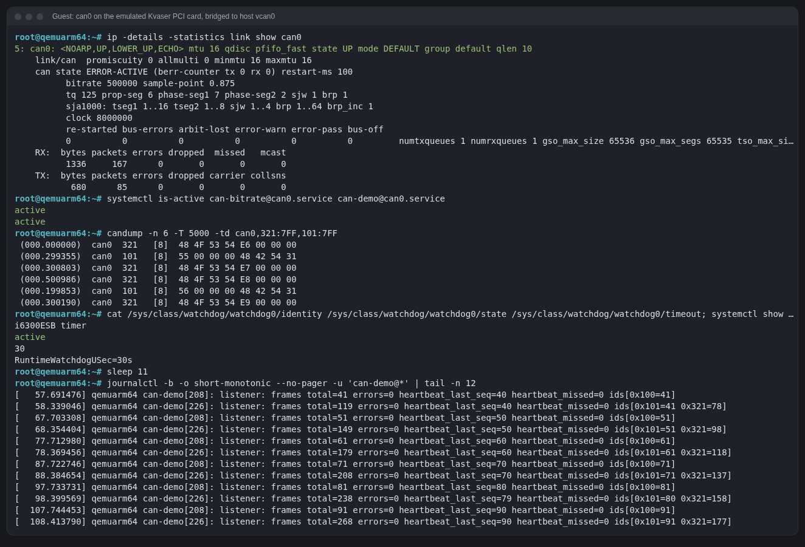

# Watching the guest's CAN bus from the host

Goal: the Rust service in the QEMU guest talks CAN, and you watch (and
inject) that traffic on the host with ordinary SocketCAN tools.

## The path a frame takes

```
guest                                         host
─────                                         ────
can-demo@can0 ── CAN_RAW socket ─┐
                                  can0  (kvaser_pci driver, SJA1000)
                                   │
                         QEMU: -device kvaser_pci,canbus=canbus0
                         QEMU: -object can-bus,id=canbus0
                         QEMU: -object can-host-socketcan,if=vcan0,canbus=canbus0
                                   │
                                   └──────────────►  vcan0  ──►  any SocketCAN tool / CAN analyzer
                                                            ──►  scripts/can-watch.py (DBC decode)
                                                            ◄──  host-can.py (sends 0x321)
```

Frame ids used:

| Id | Sender | Payload |
|---|---|---|
| `0x100` | can-demo on guest `vcan0` (never leaves the guest) | `seq:u32 LE` + `"HBT1"` |
| `0x101` | can-demo on guest `can0`, so it reaches the host | `seq:u32 LE` + `"HBT1"` |
| `0x321` | `scripts/host-can.py` on the host | `"HOST"` + `count:u32 LE` |

[`docs/can-demo.dbc`](can-demo.dbc) describes all three.

## Host prerequisites (need root, once per boot)

```sh
sudo modprobe vcan
sudo ip link add dev vcan0 type vcan
sudo ip link set up vcan0
```

Run these by hand; nothing in this repo uses sudo. `vcan0` disappears on
reboot. To make it permanent, a systemd-networkd `.netdev` file on the host
(`/etc/systemd/network/80-vcan0.netdev` with `[NetDev] Name=vcan0 Kind=vcan`)
or a `modules-load.d` + unit would do; not done here because it changes the
host's system configuration.

## Why the kas container needs `--network host`

QEMU runs inside the kas Docker container. A container has its own network
namespace, and network interfaces (vcan0 included) belong to a namespace, so
by default QEMU's `can-host-socketcan` could not see the host's `vcan0`.
`scripts/qemu-smoke.sh` starts the container with

```sh
scripts/kas --runtime-args "--network host" shell kas/qemuarm64.yml -c "..."
```

which shares the host's network namespace. Opening a `CAN_RAW` socket needs
no extra privilege, so nothing else is required. (Running the Yocto-built
QEMU directly on the host would also work, but runqemu then needs paths from
inside the container; the container route was simpler.)

## In the guest

The PCI Kvaser card shows up and the drivers bind (from
[first-boot.log](first-boot.log)):

```
[   16.601056] sja1000 CAN netdevice driver
[   16.661625] kvaser_pci 0000:00:06.0: initializing device 10e8:8406
[   18.348260] kvaser_pci 0000:00:06.0 can0: setting BTR0=0x00 BTR1=0x1c
[  OK  ] Finished Configure bit rate and bring up CAN interface can0.
[  OK  ] Started CAN heartbeat sender and frame counter on can0.
```

`can-bitrate@can0.service` starts *because* `can0` appeared (it is wanted by
`sys-subsystem-net-devices-can0.device`); boot QEMU without the card and it
never runs, so no failed unit.



The journal lines of `can-demo[226]` (the can0 instance) count both its own
`0x101` heartbeats (looped back locally by SocketCAN) and the host's `0x321`
frames that crossed the bridge, with `heartbeat_missed=0`.

## On the host

### A GUI CAN analyzer

During the project the bridge was also checked with my own SocketCAN-based
CAN analyzer tool (a desktop app, not part of this repo): connected to
`vcan0` with [`docs/can-demo.dbc`](can-demo.dbc) loaded, it showed
`101 EdgeHeartbeat` every 1.00 s with the `Seq` signal decoded and
`321 HostPing` every ~500 ms while `HOLD=600 scripts/qemu-smoke.sh` kept the
guest running. Any SocketCAN tool that reads DBC files (SavvyCAN, cantools'
`monitor`, Wireshark for the raw frames) can do the same.

### can-watch.py: the same, from a terminal

[`scripts/can-watch.py`](../scripts/can-watch.py) prints live frames from a
SocketCAN interface and decodes them with one or more DBC files. It uses only
the Python standard library (`AF_CAN` sockets, and the small DBC reader in
[`scripts/minidbc.py`](../scripts/minidbc.py)):

```sh
scripts/can-watch.py vcan0 docs/can-demo.dbc --secs 10
```

Output for the same payloads the guest and `host-can.py` send (replayed on
host `vcan0` to check the tool, two seconds):

```
can-watch: vcan0 for 2.2s, 1 DBC file(s), 3 messages
     0.157  321  [8]  48 4F 53 54 E6 00 00 00  HostPing Magic=1414745928 Count=230
     0.157  101  [8]  A0 00 00 00 48 42 54 31  EdgeHeartbeat Seq=160 Magic=827605576
     0.658  321  [8]  48 4F 53 54 E7 00 00 00  HostPing Magic=1414745928 Count=231
     1.158  321  [8]  48 4F 53 54 E8 00 00 00  HostPing Magic=1414745928 Count=232
     1.159  101  [8]  A1 00 00 00 48 42 54 31  EdgeHeartbeat Seq=161 Magic=827605576
     1.659  321  [8]  48 4F 53 54 E9 00 00 00  HostPing Magic=1414745928 Count=233
summary: 101=2 321=4
```

The host has no `candump` (can-utils is not installed and installing it
needs root), so `can-watch.py` and `host-can.py` stand in for it on the host.

### Automated check

`qemu-smoke.sh` starts `host-can.py` on host `vcan0` before booting and reads
its summary afterwards: the final run received **518 guest heartbeats
(id 0x101)** over the ~9 minutes the bridge was up, and the guest's
`candump can0` saw the host's 0x321 frames, so both directions work.

## Evaluated alternatives (before the host had a vcan0)

Before `vcan0` existed on the host, the plan had to work without root.
SLCAN over a pseudo-terminal works at the protocol level (QEMU virtio-serial
→ unix socket → `socat` → pty), but GUI tools that only list udev-enumerated
serial ports cannot select a pty. A network transport such as **socketcand**
(`< open vcan0 >`, `< rawmode >`, frames as `< frame id sec.usec data >` over
TCP) or cannelloni would avoid root entirely and also reach a real device on
the network.

## Why can-demo uses `libc` and no CAN crate

For a small embedded service that only needs one SocketCAN socket, a full
CAN library (async runtime, serial and USB transports) is a lot of crates to
vendor, cross-compile and audit in the Yocto recipe. can-demo uses `libc`
only (see `apps/can-demo/src/can.rs`).
