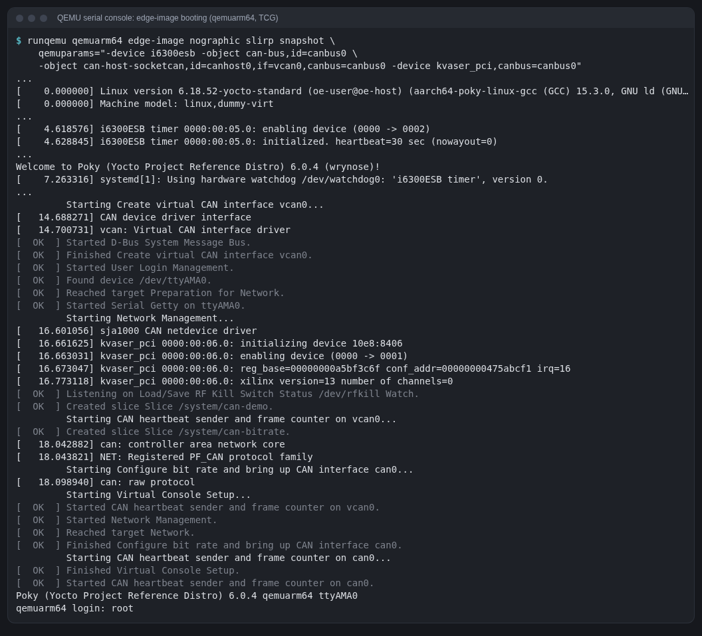
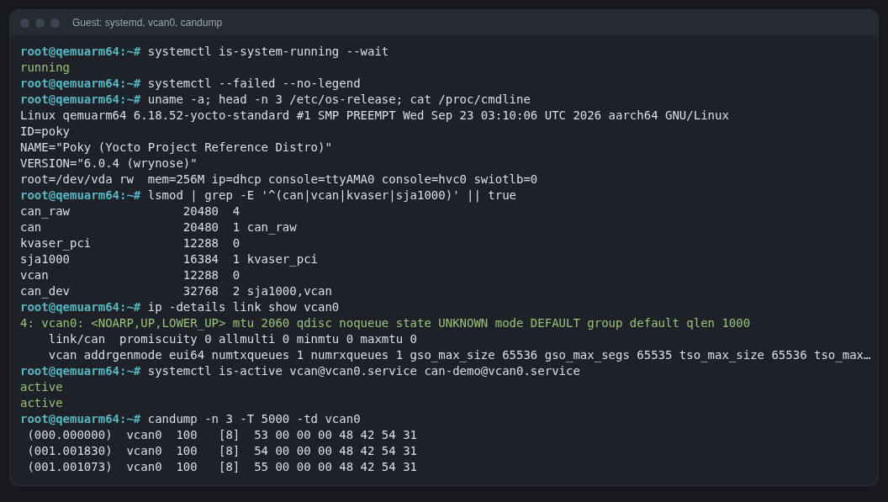
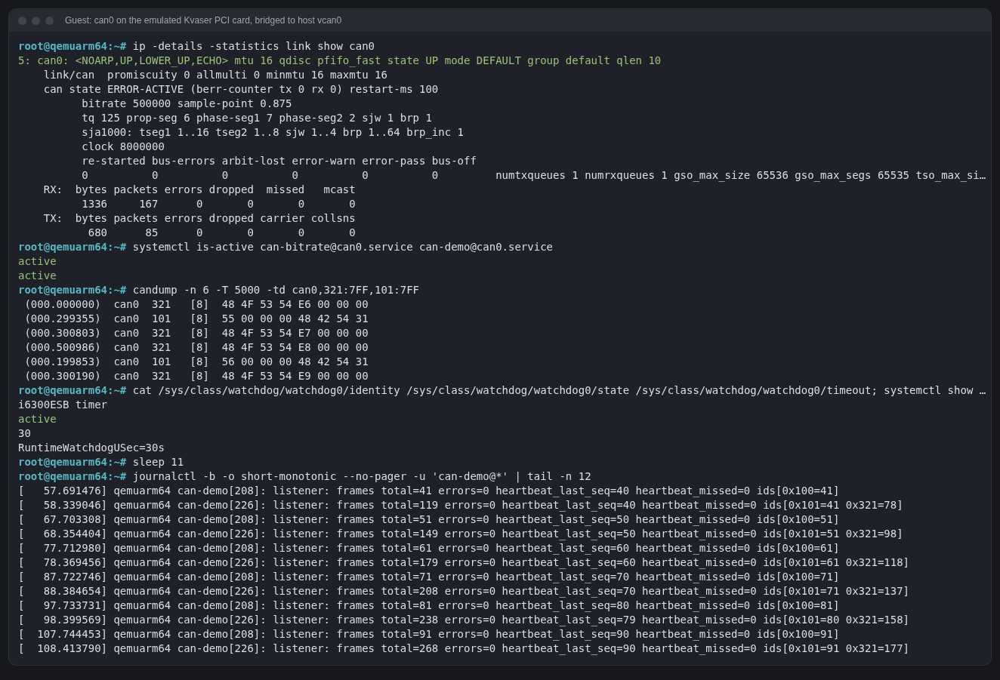
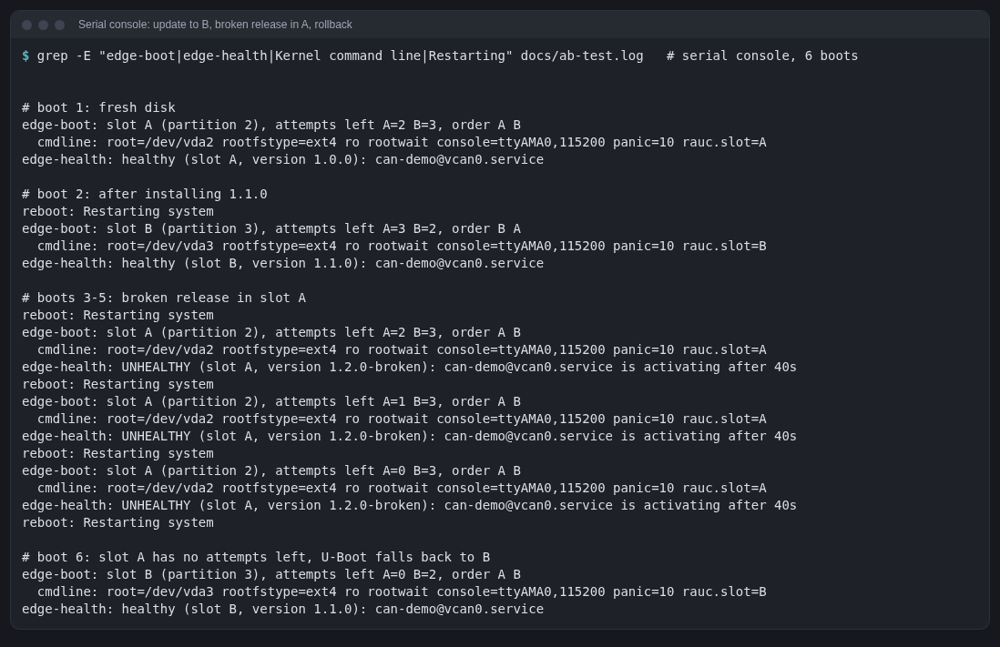
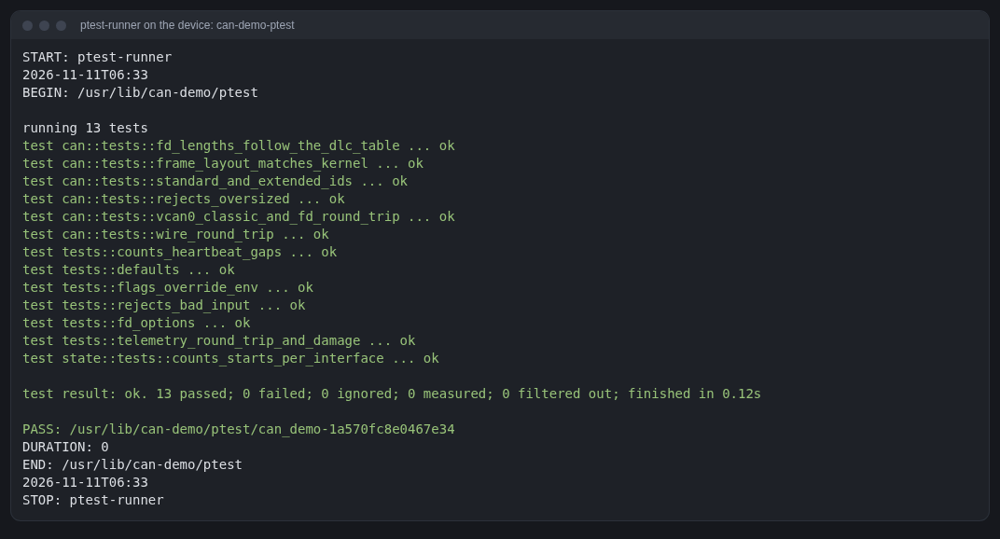
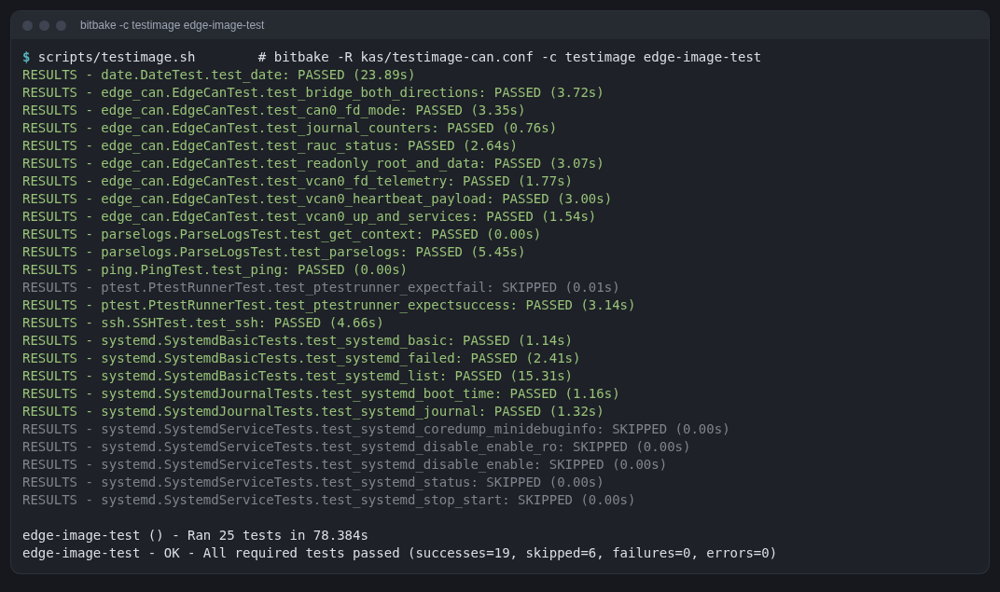
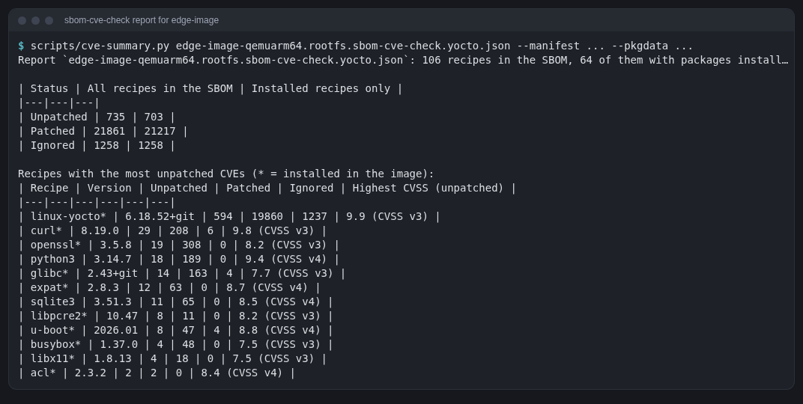
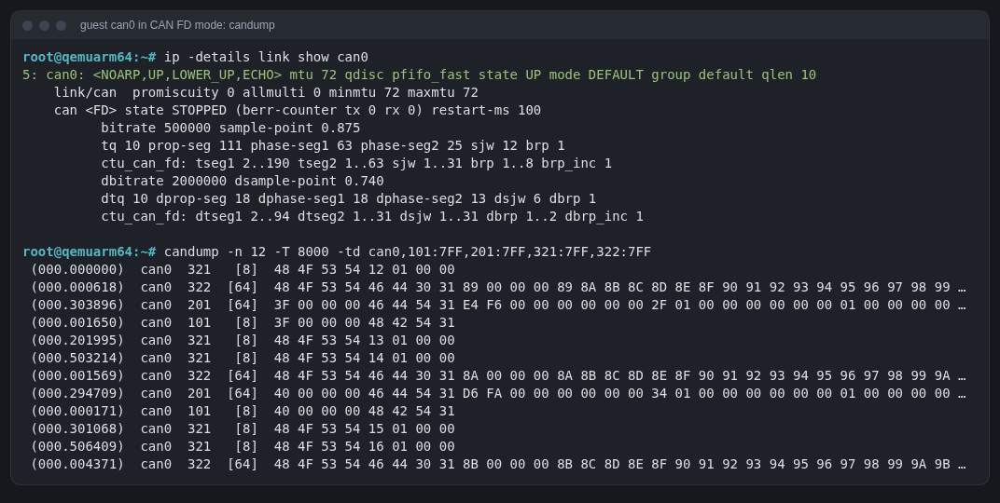
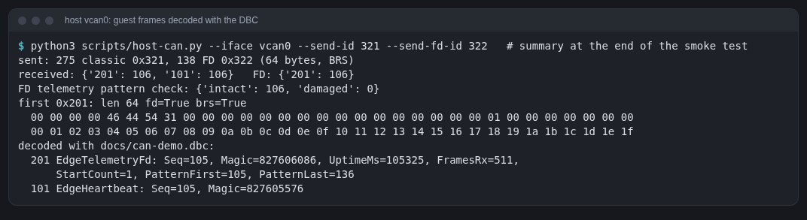

# Yocto for a Rust and industrial-protocols engineer

This guide walks through this repository in the order it was built. It assumes
you know Rust, Linux on the command line and CAN as a protocol, and that you
have not used Yocto before. Each concept is explained where the project first
needs it. What actually happened during the build (commands, timings, errors
and fixes) is in [build-journal.md](build-journal.md).

Contents

1. [What Yocto is, in one page](#1-what-yocto-is-in-one-page)
2. [Releases and why this project uses 6.0 "Wrynose"](#2-releases)
3. [kas: one YAML file instead of a setup ritual](#3-kas)
4. [Layers](#4-layers)
5. [Machine, distro, image](#5-machine-distro-image)
6. [Recipes and the task pipeline](#6-recipes-and-the-task-pipeline)
7. [bbappend: changing someone else's recipe](#7-bbappend)
8. [Kernel configuration fragments](#8-kernel-configuration-fragments)
9. [Building Rust: the cargo recipe flow](#9-building-rust-the-cargo-recipe-flow)
10. [systemd units in an image](#10-systemd-units-in-an-image)
11. [Where the build puts things: DL_DIR, SSTATE_DIR, TMPDIR, rm_work](#11-where-the-build-puts-things)
12. [runqemu](#12-runqemu)
13. [CAN on Linux: SocketCAN, vcan, real controllers](#13-can-on-linux)
14. [Bridging the guest's CAN bus to the host](#14-bridging-the-guests-can-bus-to-the-host)
15. [Partitioning with wic](#15-partitioning-with-wic)
16. [A read-only root filesystem](#16-a-read-only-root-filesystem)
17. [Overlays and the data partition](#17-overlays-and-the-data-partition)
18. [The bootloader, its environment, boot counting](#18-the-bootloader-its-environment-boot-counting)
19. [RAUC: slots, bundles, signing](#19-rauc-slots-bundles-signing)
20. [Health checks and rollback](#20-health-checks-and-rollback)
21. [Testing it: scripts/qemu-ab.sh](#21-testing-it-scriptsqemu-absh)
22. [ptest: a package's own tests, on the device](#22-ptest-a-packages-own-tests-on-the-device)
23. [oeqa and testimage](#23-oeqa-and-testimage-oe-cores-test-framework)
24. [SBOM and CVE checking (and the EU Cyber Resilience Act)](#24-sbom-and-cve-checking)
25. [Pinning sources: SRCREV](#25-pinning-sources-srcrev)
26. [CAN FD](#26-can-fd)
27. [Debugging a device model: QEMU against the Linux driver](#27-debugging-a-device-model-qemu-against-the-linux-driver)
28. [Carrying a patch in Yocto](#28-carrying-a-patch-in-yocto)
29. [Upstreaming etiquette](#29-upstreaming-etiquette)
30. [DISTRO_FEATURES: trimming a distro for a headless device](#30-distro_features-trimming-a-distro-for-a-headless-device)
31. [Following a stable branch: layer updates](#31-following-a-stable-branch-layer-updates)
32. [CVE triage: from a report to decisions](#32-cve-triage-from-a-report-to-decisions)
33. [Glossary](#33-glossary)

---

## 1. What Yocto is, in one page

Yocto is not a Linux distribution. It is a set of tools and metadata for
**building your own** distribution from source, for a specific board, in a
reproducible way. You describe *what* you want (a kernel, a C library, systemd,
your application, a few config files) and it builds everything, including the
cross-compilers, and produces a bootable image.

The pieces:

| Piece | What it is |
|---|---|
| **BitBake** | The build engine. A task scheduler written in Python that reads metadata and runs tasks (fetch, compile, package...) in dependency order, many in parallel. Think `cargo` + `make` for a whole OS. |
| **OpenEmbedded-Core (oe-core)** | The core metadata: recipes for gcc, glibc, busybox, systemd, the Linux kernel, Rust, Python and ~900 more; the classes (`cargo.bbclass`, `systemd.bbclass`, ...) that recipes reuse; QEMU machine definitions. |
| **Poky** | The Yocto Project's *reference distribution* configuration (`meta-poky`, in the `meta-yocto` repo). A sane default distro policy. |
| **Layers** | Git repos (or directories) of metadata that add or change things. Your product is one or more layers on top of the above. |

Why industry uses it instead of Debian or Buildroot:
- **Reproducible, auditable builds**: every package is built from pinned source
  with recorded checksums and licences (an SBOM and licence manifest fall out of
  the build).
- **Long-term maintenance**: LTS releases get security fixes for 4 years.
- **Customisation without forking**: you never edit upstream recipes; you add
  layers that append to them.
- **Cross-compilation for any architecture** handled for you.

The price: the first build compiles a whole toolchain and OS from source and
takes hours, and the concepts take a while to sink in. That is what this guide
is for.

## 2. Releases

Yocto makes a release every six months, named after a place. Every second year
the April release is an **LTS** (4 years of support). At the time of writing
(November 2026):

| Version | Codename | Status |
|---|---|---|
| 5.0 | Scarthgap | LTS (April 2024) |
| 6.0 | **Wrynose** | **LTS (April 2026)**, point release 6.0.4 |
| 6.1 | (next) | in development (milestones M1–M3 tagged) |

How this was checked (no guessing from memory):

```sh
git ls-remote --heads https://git.openembedded.org/openembedded-core   # branches: scarthgap, ..., whinlatter, wrynose
git ls-remote --tags  https://git.openembedded.org/openembedded-core 'yocto-6.0*'
```

Every layer has a branch per release (`wrynose`), and the layer's
`conf/layer.conf` declares which releases it works with
(`LAYERSERIES_COMPAT_edge = "wrynose"`). Mixing layers from different releases
is the classic beginner mistake; BitBake refuses to parse when the compat
strings do not match.

**Change in 6.0**: the old `poky` repository (bitbake + oe-core + meta-poky in
one tree) is no longer published for new releases. You check out **bitbake**,
**openembedded-core** and **meta-yocto** separately. oe-core's
`oe-init-build-env` looks for bitbake in `../bitbake`, which is why the kas
file names the repos exactly `bitbake` and `openembedded-core`. Also, bitbake
has its own version numbers: Yocto 6.0 uses bitbake **2.18** (I first wrote
2.16 and had to correct it by checking which branch contains the tag commit).

## 3. kas

Without a tool, setting up a Yocto build means cloning N repos at the right
commits, sourcing `oe-init-build-env`, editing `conf/bblayers.conf` and
`conf/local.conf` by hand. Nothing records that state, so "works on my
machine" happens fast.

**kas** (by Siemens) replaces this with one YAML file:
[`kas/qemuarm64.yml`](../kas/qemuarm64.yml). It lists the repos with
pinned commits, which layers inside each repo to enable, `machine`, `distro`,
`target`, and extra lines for `local.conf`. `kas build file.yml` clones,
checks out, generates the conf files and runs bitbake.

**kas-container** runs kas inside the official kas Docker image (Debian 13).
That matters here because the host is Arch Linux, which Yocto does not list as
a supported build host: the build host's compilers and libraries leak into
"native" tools, so Yocto tests against specific distros. The container gives a
supported one without touching the host.

The project wraps it in [`scripts/kas`](../scripts/kas), which only sets four
environment variables so every heavy directory lands on the external build
disk:

| Variable | Here | Holds |
|---|---|---|
| `KAS_WORK_DIR` | `/mnt/yocto/work` | the cloned layer repos |
| `KAS_BUILD_DIR` | `/mnt/yocto/build` | `conf/`, `tmp/` (all build output) |
| `DL_DIR` | `/mnt/yocto/downloads` | source tarballs and git mirrors |
| `SSTATE_DIR` | `/mnt/yocto/sstate` | the shared-state cache |

Inside the container these appear as `/work`, `/build`, `/downloads`,
`/sstate`, and this repository as `/repo`. `kas build` mounts `/repo`
read-only; `kas shell` mounts it read-write (needed later for
`update_crates`, which writes a file into the layer).

Commands used:

```sh
scripts/kas build kas/qemuarm64.yml                    # full build
scripts/kas shell kas/qemuarm64.yml                    # interactive shell with bitbake on PATH
scripts/kas shell kas/qemuarm64.yml -c 'bitbake -p'    # just parse all recipes (fast sanity check)
scripts/kas --runtime-args "--network host" shell ...  # share the host network namespace (CAN bridge)
```

## 4. Layers

A layer is a directory with `conf/layer.conf` and recipes underneath. This
build uses five:

```
openembedded-core/meta      core     toolchain, glibc, systemd, kernel, rust ...
meta-yocto/meta-poky        yocto    the "poky" distro policy
meta-openembedded/meta-oe   openembedded-layer   extra packages; we need it for can-utils
layers/meta-edge            edge     ours (this repo)
bitbake                     (not a layer: the build tool)
```

`bitbake-layers show-layers` (run in `kas shell`) prints that list with
priorities. Priority decides which layer wins when two provide the same file
or recipe. `meta-edge` has priority 10, above the upstream layers' 5.

Our [`layer.conf`](../layers/meta-edge/conf/layer.conf) explained:

```bitbake
BBPATH .= ":${LAYERDIR}"                       # where bitbake searches for conf/ and classes/
BBFILES += "${LAYERDIR}/recipes-*/*/*.bb ${LAYERDIR}/recipes-*/*/*.bbappend"
BBFILE_COLLECTIONS += "edge"                   # the layer's short name
BBFILE_PATTERN_edge = "^${LAYERDIR}/"
BBFILE_PRIORITY_edge = "10"
LAYERDEPENDS_edge = "core openembedded-layer"  # fail early if meta-oe is missing
LAYERSERIES_COMPAT_edge = "wrynose"
```

Layout convention: `recipes-<category>/<package>/<package>_<version>.bb`, with
extra files in `files/` or `<package>/` next to the recipe.

**Why can-utils needs meta-oe:** oe-core keeps a deliberately small set of
recipes; `can-utils` lives in `meta-openembedded/meta-oe/recipes-extended/socketcan/`.
Finding where a recipe lives: the OpenEmbedded layer index
(layers.openembedded.org), or grep the cgit tree for the branch.

## 5. Machine, distro, image

Three independent choices, each a config file:

- **MACHINE** (`qemuarm64`): the hardware. CPU tune (aarch64), kernel
  provider, bootloader, serial console, and for QEMU machines the `QB_*`
  variables that tell `runqemu` how to start QEMU (`-machine virt`, virtio
  disk, which serial device). For a real board you would add a BSP layer
  (e.g. `meta-raspberrypi`, `meta-freescale`) and set `MACHINE` to one of its
  machines; everything else in this repo stays the same.
- **DISTRO** (`poky`): policy. C library, init system, which features are on
  (`DISTRO_FEATURES`: systemd, ipv6, wifi, ...), default package format. In 6.0
  poky already defaults to `INIT_MANAGER = "systemd"`; the kas file sets it
  explicitly anyway so the intent is visible.
- **Image** (`edge-image`): what goes on the root filesystem. An image is
  itself a recipe ([`edge-image.bb`](../layers/meta-edge/recipes-core/images/edge-image.bb)):
  it `require`s `core-image-minimal.bb` and appends packages to
  `IMAGE_INSTALL`.

`EXTRA_IMAGE_FEATURES = "allow-empty-password empty-root-password allow-root-login"`
in the kas file makes root log in without a password on the console. That is
for a development image only; in 6.0 these three replace the old
`debug-tweaks` feature.

## 6. Recipes and the task pipeline

A recipe (`.bb`) tells BitBake how to build one piece of software. BitBake
turns every recipe into a chain of **tasks**:

```
do_fetch → do_unpack → do_patch → do_configure → do_compile → do_install
        → do_package → do_package_write_rpm → (image) do_rootfs → do_image_*
```

Each task runs in the recipe's work directory
`tmp/work/<arch>/<recipe>/<version>/`. Classes (`inherit cargo`,
`inherit systemd`, `inherit autotools`) provide the task bodies so most
recipes only declare metadata. The full build of this image is **5780 tasks** (5761 before the watchdog
recipe was added).

Smallest real example in this repo,
[`can-setup_1.0.bb`](../layers/meta-edge/recipes-connectivity/can-setup/can-setup_1.0.bb):

```bitbake
LICENSE = "MIT"
LIC_FILES_CHKSUM = "file://${COMMON_LICENSE_DIR}/MIT;md5=0835ade698e0bcf8506ecda2f7b4f302"
SRC_URI = "file://vcan@.service file://can-bitrate@.service"   # fetched from files/
inherit systemd allarch                                         # allarch: no compiled code
SYSTEMD_SERVICE:${PN} = "vcan@vcan0.service can-bitrate@can0.service"
RDEPENDS:${PN} = "iproute2 kmod"                                # runtime dependencies
do_install() {
    install -d ${D}${systemd_system_unitdir}
    install -m 0644 ${UNPACKDIR}/vcan@.service ${UNPACKDIR}/can-bitrate@.service ${D}${systemd_system_unitdir}/
}
```

Things worth knowing:
- **`LIC_FILES_CHKSUM` is mandatory.** BitBake checksums the licence text so a
  silent licence change upstream breaks the build instead of slipping through.
- **`${D}`** is the fake root you install into; packaging splits it into
  packages (`${PN}`, `${PN}-dbg`, `${PN}-dev`, ...).
- **`:${PN}`** is an *override*: `SYSTEMD_SERVICE:${PN}` means "for the main
  package". Overrides use `:` since 2021 (old docs use `_`).
- **`UNPACKDIR`** is where `file://` sources land (newer releases; old
  tutorials use `${WORKDIR}` directly).
- `bitbake -e <recipe> | grep ^VAR=` shows the final value of any variable
  after all layers, appends and overrides. That is the main debugging tool.

## 7. bbappend

You never edit a recipe in someone else's layer. You write a `.bbappend` with
the same name in your layer; BitBake concatenates it onto the original.
`%` is a wildcard for the version, so this survives kernel upgrades:

[`linux-yocto_%.bbappend`](../layers/meta-edge/recipes-kernel/linux/linux-yocto_%25.bbappend)

```bitbake
FILESEXTRAPATHS:prepend := "${THISDIR}/files:"   # look for file:// sources in our files/ first
SRC_URI += "file://can.cfg"                       # add our kernel config fragment
```

`:=` evaluates immediately (so `THISDIR` is our directory, not the original
recipe's); `:prepend` puts our path before the existing ones.

## 8. Kernel configuration fragments

`linux-yocto` builds the kernel config from a base defconfig plus
**fragments**: small `.cfg` files with only the options you care about. Any
`file://*.cfg` in `SRC_URI` is merged in during `do_kernel_configme`, and
`do_kernel_configcheck` warns if an option you asked for did not end up in the
final `.config` (usually a missing dependency).

[`can.cfg`](../layers/meta-edge/recipes-kernel/linux/files/can.cfg) enables:

| Option | Why |
|---|---|
| `CONFIG_CAN` | the SocketCAN protocol family (`PF_CAN`) |
| `CONFIG_CAN_RAW` | `CAN_RAW` sockets: what candump and can-demo use |
| `CONFIG_CAN_BCM` | broadcast manager: kernel-side cyclic send / content filters |
| `CONFIG_CAN_GW` | kernel CAN gateway/router (`cangw`) |
| `CONFIG_CAN_DEV`, `CAN_NETLINK`, `CAN_CALC_BITTIMING` | driver infrastructure; lets `ip link set can0 type can bitrate 500000` compute bit timing |
| `CONFIG_CAN_VCAN` | virtual CAN interfaces |
| `CONFIG_CAN_SJA1000`, `CONFIG_CAN_KVASER_PCI` | driver for QEMU's `kvaser_pci` device (an SJA1000 controller on PCI) |
| `CONFIG_CAN_CTUCANFD`, `CONFIG_CAN_CTUCANFD_PCI` | driver for QEMU's `ctucan_pci` (CAN FD capable), kept as an alternative |

They are `=m` (modules). Modules end up in packages named
`kernel-module-<name>` with `_` turned into `-` (`kvaser_pci.ko` →
`kernel-module-kvaser-pci`), which is how the image recipe pulls them in.

In this build `do_kernel_configcheck` succeeded with no warnings, so every
option in `can.cfg` and `watchdog.cfg` reached the final `.config`; the boot
log then shows the drivers loading.

Useful commands (for reference; this build did not need them):

```sh
bitbake -c menuconfig virtual/kernel      # interactive; needs a terminal
bitbake -c diffconfig virtual/kernel      # writes a fragment of what you changed
bitbake -c kernel_configcheck -f virtual/kernel
grep CAN tmp/work/qemuarm64-poky-linux/linux-yocto/*/build/.config   # (before rm_work deletes it)
```

## 9. Building Rust: the cargo recipe flow

oe-core 6.0 ships its own Rust toolchain (1.94.1), built from source as part of
the build: `rust-native` (a host compiler), `libstd-rs` for the target, and
`cargo`. Recipes use it through classes:

- **`cargo.bbclass`**: `do_compile` runs `cargo build --release --frozen
  --offline` with the cross target (`aarch64-poky-linux-gnu`), and `do_install`
  copies the binaries to `/usr/bin`.
- **The network is off during compile.** Every crate must be fetched in
  `do_fetch` like any other source, with a checksum. Crates are listed in
  `SRC_URI` as `crate://crates.io/<name>/<version>` and BitBake's crate fetcher
  downloads them; `cargo_common` writes a `.cargo/config` that points cargo at
  the vendored copies.
- **`cargo-update-recipe-crates.bbclass`** adds a task that reads
  `Cargo.lock` and writes that list for you:

```sh
scripts/kas shell kas/qemuarm64.yml -c 'bitbake -c update_crates can-demo'
# writes layers/meta-edge/recipes-apps/can-demo/can-demo-crates.inc
```

The recipe ([`can-demo_0.1.0.bb`](../layers/meta-edge/recipes-apps/can-demo/can-demo_0.1.0.bb))
first took its source straight from this repository's working tree (part 3
replaced this with a git fetch at a pinned commit, [chapter 25](#25-pinning-sources-srcrev)):

```bitbake
FILESEXTRAPATHS:prepend := "${THISDIR}/../../../../apps:"
SRC_URI = "file://can-demo/ file://can-demo@.service file://can-demo-can0.default"
S = "${UNPACKDIR}/can-demo"
inherit cargo cargo-update-recipe-crates systemd
require ${BPN}-crates.inc
```

`file://` on a directory means BitBake checksums every file in it, so editing
the Rust code reruns the recipe. In a product you would usually point
`SRC_URI` at a git repo (`git://...;protocol=https;branch=main` plus
`SRCREV`), so the image records exactly which commit it contains; this
project does that since part 3.

Design choice: the app talks to SocketCAN through `libc` directly (one
dependency) instead of the `socketcan` crate (about a dozen). Fewer crates
means a shorter `crates.inc` and less to audit; the cost is about 200 lines
(tests included) of mostly `unsafe` socket code in
[`src/can.rs`](../apps/can-demo/src/can.rs), with the kernel struct layouts
checked by unit tests.

## 10. systemd units in an image

`inherit systemd` plus `SYSTEMD_SERVICE:${PN}` makes the package enable those
units at image build time (it runs `systemctl preset` against the root
filesystem, so nothing has to happen on first boot). Template units work:
listing `can-demo@vcan0.service` enables an instance of `can-demo@.service`.
One catch, found the hard way ([build journal, problem 6](build-journal.md#problem-6-template-unit-files-not-packaged-run-2)):
the class does not put the template file itself into the package, so the
recipe must add it: `FILES:${PN} += "${systemd_system_unitdir}/can-demo@.service"`.

The units in this project, and why each line is there:

**`vcan@.service`** (oneshot): `modprobe vcan`, `ip link add dev %I type vcan`,
`ip link set dev %I up`. `RemainAfterExit=yes` keeps it "active" after the
commands finish so other units can order after it. Enabled for `vcan0`,
`WantedBy=multi-user.target`.

**`can-bitrate@.service`** (oneshot): a real CAN controller must have a bit
rate before it can go up. `ip link set %I type can bitrate 500000 restart-ms 100`
then `up` (since part 3 through `/usr/libexec/can-up`, which adds the CAN FD
data bit rate when the controller supports it, [chapter 26](#26-can-fd)). It is `WantedBy=sys-subsystem-net-devices-%i.device`: systemd
creates a `.device` unit for every network interface, so this starts *when
can0 appears*, which is when the PCI driver binds. If the hardware is absent
(QEMU started without the CAN device), it simply never starts; no failed unit.

**`can-demo@.service`**: the Rust service, one instance per interface.

```ini
BindsTo=sys-subsystem-net-devices-%i.device   # stop if the interface disappears
After=... can-bitrate@%i.service vcan@%i.service
Type=notify            # the app sends READY=1 over $NOTIFY_SOCKET
WatchdogSec=10s        # and WATCHDOG=1 at least every 5 s, or systemd restarts it
DynamicUser=yes        # runs as a throwaway unprivileged user
RestrictAddressFamilies=AF_CAN AF_UNIX AF_NETLINK
CapabilityBoundingSet= # no capabilities: a CAN_RAW socket does not need any
EnvironmentFile=-/etc/default/can-demo-%i     # e.g. CAN_DEMO_ID=0x101 for can0
WantedBy=sys-subsystem-net-devices-%i.device
```

**`edge-watchdog`** (a config drop-in, not a unit): systemd itself can feed
a hardware watchdog. `/usr/lib/systemd/system.conf.d/10-watchdog.conf` sets
`RuntimeWatchdogSec=30s`: PID 1 pets `/dev/watchdog0`, and if PID 1 hangs
the hardware resets the machine. In QEMU the hardware is `-device i6300esb`
(an Intel PCI watchdog), driver `CONFIG_I6300ESB_WDT=y` from
`watchdog.cfg`. Boot log: `systemd[1]: Using hardware watchdog
/dev/watchdog0: 'i6300ESB timer'`. Two levels, then: systemd restarts a
hung *service* (`WatchdogSec=` per unit), the hardware resets a hung
*system*. (A reset was not provoked in this build.)

Logging: the app writes to stdout; systemd connects stdout to the journal and
sets `$JOURNAL_STREAM`. When that variable is present the app prefixes lines
with `<6>` / `<4>` / `<3>` (info/warning/error), which journald turns into
priorities (`journalctl -p warning` works). No logging crate needed.

## 11. Where the build puts things

| Directory | What | Size here | Safe to delete? |
|---|---|---|---|
| `DL_DIR` | source archives, git mirrors | 8.4 GB | yes, but you re-download |
| `SSTATE_DIR` | **shared state cache**: the packaged output of every task, keyed by a hash of all its inputs | 4.9 GB | yes, but you rebuild from scratch |
| `build/tmp` | work dirs, sysroots, `deploy/images` (the result) | 18 GB (peak 42 GB while building) | yes (`rm -rf tmp`); sstate makes the rebuild fast |
| `build/cache` | parsed recipe cache, hash equivalence DB | small | yes |

**sstate** is why the second build takes minutes instead of hours. Before
running a task, BitBake computes its signature (hash of the recipe, the
variables it uses and its dependencies' signatures). If an sstate object with
that signature exists, it unpacks it instead of running the task
(`Running setscene task` in the log). Share `SSTATE_DIR` (or serve it over
HTTP with `SSTATE_MIRRORS`) across builds and machines.
`BB_HASHSERVE_DB_DIR = "${SSTATE_DIR}"` keeps the *hash equivalence* database
(which lets two different signatures share output when the result is
byte-identical) next to the cache; BitBake warned about this on the first
parse.

**`INHERIT += "rm_work"`** deletes each recipe's work directory once its
output is packaged. Without it `tmp/` for this image would be tens of GB more.
The cost: you can't inspect a recipe's build tree afterwards. Exclude a recipe
with `RM_WORK_EXCLUDE += "can-demo"` while you debug it.

`BB_DISKMON_DIRS` makes BitBake stop starting new tasks when free space drops
under 1 GB, instead of failing halfway through writing a file.

## 12. runqemu

oe-core builds its own QEMU (`qemu-system-native`) and ships the `runqemu`
script, which reads the `QB_*` variables of the machine and the deploy
directory and starts the right command line. Typical use in `kas shell`:

```sh
runqemu qemuarm64 edge-image nographic slirp
```

- `nographic`: no window, serial console on your terminal (exit with `Ctrl-a x`).
- `slirp`: user-mode networking; no root needed (the default `tap` needs sudo
  to create a tap device).
- `qemuparams="..."`: extra QEMU arguments appended to the command line.
- `snapshot`: writes go to a temporary overlay and the image file stays
  untouched. Required here because the image is deployed as `.ext4.zst`
  (runqemu decompresses it to a temporary file only in snapshot mode).
- KVM does not help here: the host is x86-64 and the guest is aarch64, so QEMU
  emulates the CPU (TCG). That is why boot takes tens of seconds.

[`scripts/qemu-smoke.sh`](../scripts/qemu-smoke.sh) automates boot and test.
It runs [`qemu-smoke.py`](../scripts/qemu-smoke.py) inside `kas shell`, which
starts runqemu on a pseudo-terminal, waits for `login:`, logs in as root and
runs commands wrapped in markers so it can read each command's output and exit
code (`expect` in about 200 lines of Python). The full serial log is saved to
[`first-boot.log`](first-boot.log).





## 13. CAN on Linux

**SocketCAN** puts CAN into the normal Linux network stack: each controller is
a network interface (`can0`), and applications use BSD sockets of family
`PF_CAN`. A `CAN_RAW` socket bound to `can0` reads and writes
`struct can_frame` (16 bytes: 32-bit id with flag bits, length, 8 data bytes):

```rust
// apps/can-demo/src/can.rs (classic frames; CAN FD: chapter 26)
#[repr(C)]
struct RawCanFrame { can_id: u32, len: u8, _pad: u8, _res0: u8, _len8_dlc: u8, data: [u8; 8] }
// socket(PF_CAN, SOCK_RAW, CAN_RAW); bind(sockaddr_can { ifindex }); read()/write() whole frames
```

The top bits of `can_id` are flags: `0x80000000` extended (29-bit) id,
`0x40000000` remote frame, `0x20000000` error frame.

Things that surprise people coming from a CAN adapter API:

- **Local loopback.** A frame sent on `can0` is delivered to every *other*
  socket on the same host bound to `can0` as if it came from the bus. That is
  why can-demo's listener (a second socket) counts its own heartbeats, and why
  `candump` in the guest shows them. The sending socket itself does not get it
  back unless it sets `CAN_RAW_RECV_OWN_MSGS`.
- **vcan** is a virtual interface with no bus at all: everything sent is
  looped back locally. Perfect for testing software, says nothing about bit
  timing or bus errors.
- **Real controllers need a bit rate** (`ip link set can0 type can bitrate
  500000`) before `up`, and report bus state (`ERROR-ACTIVE`,
  `ERROR-PASSIVE`, `BUS-OFF`) in `ip -details link show can0`.
  `restart-ms 100` makes the driver recover from bus-off automatically.
- **can-utils**: `candump can0` (receive), `cansend can0 123#DEADBEEF`
  (send), `cangen` (random traffic), `canbusload`, `isotpsend/isotprecv`, ...

## 14. Bridging the guest's CAN bus to the host

QEMU can emulate CAN controllers and connect them to a virtual bus:

```
-object can-bus,id=canbus0                                   # a virtual CAN bus inside QEMU
-object can-host-socketcan,id=canhost0,if=vcan0,canbus=canbus0   # bridge that bus to host vcan0
-device kvaser_pci,canbus=canbus0                            # a PCI CAN card (SJA1000) on that bus
```

The guest sees a PCI Kvaser card; the `kvaser_pci` driver binds and creates
`can0`. (Part 3 replaced it with a CAN FD controller, `ctucan_pci`:
[chapter 26](#26-can-fd).) Frames the guest sends on `can0` appear on the host's `vcan0`, and
frames written to host `vcan0` arrive at guest `can0`. On the host you can
watch with any SocketCAN tool, or with `scripts/can-watch.py`, which decodes
the frames with [`docs/can-demo.dbc`](can-demo.dbc).

Two practical requirements:

1. **Host `vcan0` must exist.** Creating it needs root, once per boot:
   ```sh
   sudo modprobe vcan
   sudo ip link add dev vcan0 type vcan
   sudo ip link set up vcan0
   ```
2. **QEMU must see the host's network namespace.** QEMU runs inside the kas
   Docker container, which has its own network namespace with no `vcan0`.
   `scripts/kas --runtime-args "--network host" shell ...` shares the host's.

Details and results: [can-bridge.md](can-bridge.md).



## Part 2: read-only root and A/B updates

Chapters 15 to 21 cover the second stage of the project: the image became a
real disk with two root filesystem slots, a read-only root, a data
partition, U-Boot, and RAUC for signed updates with automatic rollback. The
commands and problems are in [build-journal.md](build-journal.md#part-2-read-only-root-and-ab-updates).

The idea in one picture:

```
 QEMU flash bank 1             virtio disk /dev/vda (the wic image)
 ┌────────────────────┐        ┌──────────┬────────────┬────────────┬─────────────────────┐
 │ U-Boot environment │        │ vda1     │ vda2       │ vda3       │ vda4                │
 │  BOOT_ORDER=A B    │        │ boot     │ rootfs A   │ rootfs B   │ data                │
 │  BOOT_A_LEFT=3     │        │ FAT      │ ext4, ro   │ ext4, ro   │ ext4, read-write    │
 │  BOOT_B_LEFT=3     │        │ boot.scr │ kernel +   │ kernel +   │ /etc and /var/lib   │
 └────────────────────┘        │          │ rootfs     │ rootfs     │ overlays, journal,  │
   read and written by         │          │ 1.0.0      │ (empty)    │ RAUC status         │
   U-Boot (boot.scr) and       └──────────┴────────────┴────────────┴─────────────────────┘
   Linux (fw_setenv, RAUC)
```

1. U-Boot (QEMU's firmware) runs `boot.scr`, which reads `BOOT_ORDER`,
   picks the first slot that still has attempts left, decrements its
   counter, saves the environment and boots `/boot/Image` from that slot with
   `rauc.slot=A` (or `B`) on the kernel command line.
2. Linux mounts that slot read-only. State lives on `/data`.
3. When the system decides it is healthy, `rauc status mark-good` resets
   the slot's counter to 3.
4. `rauc install bundle.raucb` checks the bundle's signature, writes the new
   rootfs image into the *other* slot and puts that slot first in
   `BOOT_ORDER`. The running system is never modified.
5. If the new slot never becomes healthy, every boot of it uses one attempt;
   at 0, U-Boot boots the old slot again. That is the rollback.

## 15. Partitioning with wic

So far the build produced a bare ext4 file (`edge-image-qemuarm64.rootfs.ext4`),
and QEMU loaded the kernel itself (`-kernel Image`). A real device boots from
a disk with a partition table, so the image needs one.

**wic** ("OpenEmbedded Image Creator") builds partitioned disk images. Since
Yocto 6.0 it is its own project (`wic-native` recipe, git.yoctoproject.org/wic).
You describe the disk in a **kickstart file** (`.wks`) and add `wic` to
`IMAGE_FSTYPES`. Ours is
[`edge-ab.wks`](../layers/meta-edge/recipes-core/images/edge-ab.wks):

```
bootloader --ptable gpt
part --source bootimg_partition --fstype=vfat --label boot --active --align 1024 --fixed-size 16M
part / --source rootfs --fstype=ext4 --label rootfs_a --align 1024 --fixed-size 320M
part --fstype=ext4 --label rootfs_b --align 1024 --fixed-size 320M
part --fstype=ext4 --label data --align 1024 --fixed-size 256M
```

- Each `part` line is a partition, in order (`vda1` … `vda4`).
- `--source` names a **plugin** that fills it: `rootfs` copies the image's
  root filesystem; `bootimg_partition` copies the files listed in
  `IMAGE_BOOT_FILES` (here only U-Boot's `boot.scr`). A partition with no
  `--source` gets an empty filesystem of `--fstype`.
- `--fixed-size`: both slots must be the same size and large enough for any
  future rootfs image. Leave room to grow; changing partition sizes in the
  field is hard.
- `WKS_FILE = "edge-ab.wks"` in the image recipe selects it; wic looks next
  to the recipe and in each layer's `files/wic/`.

Gotcha: on aarch64 the wic class builds `grub-efi` and `systemd-boot` "in
case" a wks file needs them. Ours does not, so the image recipe sets
`WKS_FILE_DEPENDS_BOOTLOADERS = ""`.

## 16. A read-only root filesystem

`IMAGE_FEATURES += "read-only-rootfs"` makes the image work with `/`
mounted read-only. The class `rootfs-postcommands.bbclass` (read
`read_only_rootfs_hook`) changes `/etc/fstab` to `ro`, and the boot script
puts `ro` on the kernel command line, so `/` is never writable, not even
briefly.

Why bother on a device with A/B updates?

- **The slot is exactly the image.** Nothing on the device changes the
  installed software, so every device on version X has byte-identical
  software, and what was tested is what runs.
- **Power cuts** cannot corrupt a filesystem that is never written.
- It forces you to know **where state lives**, which you need anyway for
  updates: state that should survive an update must not live in the slot
  that the update replaces.

What still needs to be writable, and where it went in this project:

| Path | Why it is written | Solution here |
|---|---|---|
| `/run`, `/tmp`, `/var/volatile` | runtime files | tmpfs (oe-core default) |
| `/etc` | `machine-id`, admin changes | **overlay**: rootfs `/etc` below, `/data/overlay-etc/upper` on top (`overlayfs-etc`, chapter 17) |
| `/etc/machine-id` | identifies the installation; journal files are stored per machine id | written on the first boot into the `/etc` overlay, so it stays the same after updates |
| `/var/lib` | systemd state, DynamicUser state dirs (`can-demo` start counter) | overlay with `/data/var-lib` on top (`volatile-binds`, chapter 17) |
| `/var/log` | journal | symlink to `/data/log` (image post-process command); journald `Storage=persistent` |
| `/var/cache`, `/var/spool`, `/srv` | caches | tmpfs (`volatile-binds` default) |
| RAUC status | which bundle is in which slot | `data-directory=/data/rauc` in `system.conf` |

Test it: `touch /usr/x` must fail with "Read-only file system", and
`/proc/mounts` must show `/` with `ro`.

## 17. Overlays and the data partition

An **overlay filesystem** stacks a writable *upper* directory on a
read-only *lower* one. Reads see the upper file if it exists, else the
lower; writes always go to the upper; deleting a lower file leaves a
"whiteout" in the upper. The kernel needs `CONFIG_OVERLAY_FS`.

Two oe-core mechanisms use it here:

- **`overlayfs-etc`** (image feature): `/etc` must be ready before systemd
  starts (systemd reads `/etc` first thing). The class replaces `/sbin/init`
  with a small shell script that mounts the data partition
  (`OVERLAYFS_ETC_DEVICE = "/dev/vda4"`) on `/data`, mounts the `/etc`
  overlay, then `exec`s the real init (`/sbin/init.orig` → systemd).
  **Trap:** by default that script first runs `mount -o remount,rw /` to
  create mount points, which silently makes the "read-only" root writable.
  `OVERLAYFS_ETC_CREATE_MOUNT_DIRS = "0"` turns that off; the image creates
  `/data` at build time instead.
- **`volatile-binds`** (installed with read-only-rootfs): one small service
  per entry in `VOLATILE_BINDS`, each mounting an overlay (or a copy + bind
  mount) of a writable directory over a read-only one. The default puts
  tmpfs under `/var/lib`; the `.bbappend` here points `/var/lib` at
  `/data/var-lib` instead, so it persists.

What an overlay on persistent storage means for updates: the upper layer
outlives the slot. If the admin edited `/etc/foo.conf`, that edited copy
keeps hiding whatever `foo.conf` the next release ships. That is often what
you want (local configuration wins) and sometimes a bug (an old file hides a
needed new default). Real products decide per file, or keep configuration
outside `/etc` entirely; `overlayfs-etc` says so in its own comments
("update and migration strategy … is out of scope").

`/data` itself is never written by an update. A first boot (or a
reformatted partition) starts empty, so
[`edge-data-layout.service`](../layers/meta-edge/recipes-core/edge-system/files/edge-data-layout.service)
creates the directories at every boot, before the journal is flushed to
disk.

## 18. The bootloader, its environment, boot counting

`qemuarm64` normally boots without a bootloader: runqemu passes the kernel to
QEMU (`-kernel`). That cannot choose between two slots, so this stage adds
**U-Boot** (`u-boot` recipe, `qemu_arm64_defconfig`) as the firmware QEMU
runs (`-bios u-boot.bin`, set via `QB_DEFAULT_BIOS` in the image recipe).

Why U-Boot and not GRUB: both work with RAUC. U-Boot is what most ARM boards
ship, oe-core builds it for `qemuarm64` out of the box, and its environment
can live in QEMU's emulated flash just like on a board with SPI-NOR. GRUB on
aarch64 needs UEFI firmware (edk2/OVMF) built as well, and a GRUB environment
file on a FAT partition. meta-rauc-community's `meta-rauc-qemuarm` layer
uses the same U-Boot approach and was the reference for this one.

**The environment** is U-Boot's key/value store (`printenv`, `setenv`,
`saveenv`). `qemu_arm64_defconfig` keeps it in flash at `0x4000000`, the
second of the "virt" machine's two 64 MiB flash banks; the test scripts back
that bank with a file (`-drive if=pflash,index=1,file=…`) so values survive
reboots. Linux reaches the same bytes through MTD: the kernel fragment
`mtd-flash.cfg` enables the CFI flash driver, `/dev/mtd0` appears, and
`fw_printenv`/`fw_setenv` (libubootenv) read and write it as described in
`/etc/fw_env.config` (shipped by the `u-boot-env` package from our
`u-boot` bbappend).

**The boot script** ([`boot.cmd`](../layers/meta-edge/recipes-bsp/u-boot/files/boot.cmd),
compiled to `boot.scr` because the bbappend sets `UBOOT_ENV = "boot"`,
`UBOOT_ENV_SUFFIX = "scr"`) implements the boot counting:

```
for slot in "${BOOT_ORDER}"; do      # e.g. "B A" after an update
  first slot with BOOT_x_LEFT > 0  → decrement it, remember the partition
done
saveenv                              # store the decrement BEFORE booting
ext4load virtio 0:${root_part} ${kernel_addr_r} /boot/Image
booti ${kernel_addr_r} - ${fdtcontroladdr}
```

Storing the decrement before booting is the essential part: a kernel panic,
a hang caught by the watchdog, or a failed health check all end in a reboot
without anyone resetting the counter, so each costs one attempt.

Details worth knowing:

- The kernel lives inside the slot (`/boot/Image`, package
  `kernel-image-image`). Kernel and rootfs update together.
- The device tree comes from QEMU (it describes CPUs, RAM and the PCI
  devices on the command line); U-Boot passes it on as `${fdtcontroladdr}`.
  On a real board it would be a `.dtb` from the kernel build, also in the slot.
- U-Boot's "standard boot" scans the disks for `boot.scr`. On real hardware
  you would rather compile the logic into U-Boot's default environment
  (`CONFIG_BOOTCOMMAND`) so a corrupted boot partition cannot break it.

## 19. RAUC: slots, bundles, signing

**RAUC** (Robust Auto-Update Controller, by Pengutronix) is the update
client on the device. Its layer, **meta-rauc**, provides the `rauc` recipe,
the `bundle` class and config fragments for the kernel (loop, squashfs,
dm-verity) and BusyBox. `DISTRO_FEATURES:append = " rauc"` switches those
fragments on.

**Slots** are described in `system.conf` (ours:
[`system.conf`](../layers/meta-edge/recipes-core/rauc/files/system.conf),
installed by a `rauc-conf.bbappend`):

```ini
[system]
compatible=edge-qemuarm64   # bundles must say exactly this
bootloader=uboot                    # switch slots with fw_setenv
data-directory=/data/rauc           # status on the writable partition
[keyring]
path=ca.cert.pem                    # trust anchor for bundle signatures
[slot.rootfs.0]
device=/dev/vda2
type=ext4
bootname=A                          # U-Boot's name for it
[slot.rootfs.1]
device=/dev/vda3
type=ext4
bootname=B
```

RAUC knows the booted slot from `rauc.slot=A` on the kernel command line,
and only ever writes the other slot of the same class.

**A bundle** (`.raucb`) is a squashfs holding the images plus a
`manifest.raucm` (compatible string, version, image hashes), followed by a
CMS signature. With `RAUC_BUNDLE_FORMAT = "verity"` the signature covers a
dm-verity root hash, so the kernel verifies every block as RAUC reads it:
the bundle cannot be swapped after the check. The recipe is short
([`edge-bundle.inc`](../layers/meta-edge/recipes-core/bundles/edge-bundle.inc)):

```bitbake
inherit bundle
RAUC_BUNDLE_COMPATIBLE = "edge-qemuarm64"
RAUC_BUNDLE_FORMAT = "verity"
RAUC_BUNDLE_SLOTS = "rootfs"
RAUC_SLOT_rootfs = "edge-image-update"   # the image recipe whose rootfs goes in
RAUC_SLOT_rootfs[fstype] = "ext4"
RAUC_KEY_FILE = "${EDGE_KEYS_DIR}/signing.key.pem"
RAUC_CERT_FILE = "${EDGE_KEYS_DIR}/signing.cert.pem"
```

`bitbake edge-bundle` builds `edge-image-update`, then packs and signs
`edge-bundle-qemuarm64.raucb` in the deploy directory. Because the slot
type is `ext4` and the image is `.ext4`, RAUC writes the image to the
partition block for block.

**Signing and keys.** `scripts/make-dev-keys.sh` creates a development CA
and a signing certificate under `keys/dev/` (ignored by git; every subject
says "DEVELOPMENT ONLY"). The image gets only the CA certificate
(`/usr/lib/rauc/ca.cert.pem`); the build host holds the signing key. A
device accepts a bundle only if the signer's certificate chains to that CA.
In production:

- the signing key never sits on build machines (HSM or PKCS#11 token, or a
  separate signing step after CI);
- devices trust a production CA, never a development one; development
  devices may trust both;
- certificates expire and can be revoked, so plan how a device gets a new
  keyring (RAUC can update the keyring inside a bundle, signed by the old key).

The A/B test proves two refusals. Both bundles are made from the good one by
[`forge-bundles.py`](../scripts/forge-bundles.py) with plain openssl: a
verity bundle ends in `[CMS signature][8-byte size]`, and the CMS
structure carries the manifest, so it can be re-signed without touching
the payload.

```
signed by keys/dev/other-ca:
  LastError: signature verification failed: Verify error: unable to get local issuer certificate
signed with our key, manifest says compatible=some-other-product:
  LastError: Compatible mismatch: Expected 'edge-qemuarm64' but bundle manifest has 'some-other-product'
```

The second one matters as much as the first: a valid signature only says
who built the bundle, not which product it is for.

Three image recipes make the test possible from one build:
`edge-image` (1.0.0, the factory image in the wic disk), `edge-image-update`
(1.1.0, in `edge-bundle`) and `edge-image-broken` (1.2.0-broken, in
`edge-bundle-broken`: a systemd drop-in makes `can-demo@vcan0` exit with an
error, like an app release that crashes on start). The version is in
`/usr/lib/edge-release`.

## 20. Health checks and rollback

Booting is not proof that a release works. The device needs a rule for
"healthy", and only then marks the slot good. This uses systemd's boot
assessment pattern:

- [`edge-health.service`](../layers/meta-edge/recipes-core/edge-system/files/edge-health.service)
  is `RequiredBy=boot-complete.target` and `Before=` it. Its script waits
  up to 40 s for `can-demo@vcan0` to be active, then checks it stayed up
  without restarting.
- meta-rauc's `rauc-mark-good.service` runs **after** `boot-complete.target`
  and calls `rauc status mark-good`, which sets `BOOT_x_LEFT=3`.
- If the check fails, `boot-complete.target` is never reached, so the slot
  is not marked good, and `FailureAction=reboot` on the health service
  reboots. U-Boot has already taken one attempt. After three, it falls
  back to the other slot.

The other paths to rollback use the same counter: a kernel panic reboots
after `panic=10`, and a hang stops feeding the i6300esb watchdog
(chapter 10), which resets the machine. Neither resets the counter.

`rauc status mark-bad` exists too: a health check that is sure the release
is broken can mark it bad and reboot, falling back after one boot instead of
three. Counting attempts is the more general mechanism, because it also
covers the cases where nothing runs to make a decision.

What happens to the bad slot: it stays in the other partition with
`BOOT_A_LEFT=0`, shown by `rauc status` as `boot status: bad`. The next
`rauc install` overwrites it.

## 21. Testing it: scripts/qemu-ab.sh

[`qemu-ab.py`](../scripts/qemu-ab.py) runs the whole story in one QEMU
process (the guest's `reboot` resets the virtual machine but QEMU keeps
running with the same disk and flash files). It starts
`qemu-system-aarch64` directly instead of via runqemu, so the machine is
visible in one place: firmware, the flash file for U-Boot's environment,
the disk, the network and the watchdog. It copies the deployed disk image
first, so every run starts from the factory state. Bundles are served by a
small HTTP server in the test; inside the guest, `10.0.2.2` is the host side
of QEMU's user-mode network.

What the console shows over the six boots of a run (the `edge-boot` line is
U-Boot's script, the `edge-health` line the health check):



Read it from the top: slot A boots and is healthy; after `rauc install` the
order is `B A` and B boots with 1.1.0; the broken release goes into A,
which boots three times (`A=2`, `A=1`, `A=0`) and is unhealthy each time;
then U-Boot skips A and boots B again.

The serial log of a full run is [`ab-test.log`](ab-test.log); all 24
checks and the timings are in
[build-journal.md](build-journal.md#ab-test-run-2-build-6-2424-in-581-s).

## Part 3: tests in the image, SBOM and CVEs, pinned sources, CAN FD

Chapters 22 to 28 cover the third stage: the app's unit tests run on the
device (ptest), oe-core's own test framework boots the image and checks it
(testimage), the build produces an SBOM and a CVE report, the app is fetched
from git at a fixed commit, and the CAN side moved from classic CAN to
CAN FD. Commands, problems and timings:
[build-journal.md, part 3](build-journal.md#part-3-tests-sbom-and-cves-can-fd).

## 22. ptest: a package's own tests, on the device

Most open-source projects have a test suite (`make check`, `cargo test`).
Running it on the build host proves little for an embedded product: the
host has a different CPU, C library, kernel and configuration. **ptest**
("package test") is oe-core's convention for building a package's tests
for the *target* and running them *there*:

- A recipe that `inherit`s `ptest` (or a variant) gets an extra package,
  `<name>-ptest`, which installs the test programs and a script
  `/usr/lib/<name>/ptest/run-ptest`.
- `run-ptest` prints one line per test, `PASS: <name>`, `FAIL: <name>` or
  `SKIP: <name>`, and exits non-zero on failure. That output format is the
  whole contract.
- **`ptest-runner`** (a small C program in the image) finds every
  `/usr/lib/*/ptest/run-ptest`, runs each with a timeout and prints a summary.
  `ptest-runner can-demo` runs just one package.
- It only happens if `ptest` is in `DISTRO_FEATURES` (Poky has it by default)
  and the `-ptest` package is installed. The image feature `ptest-pkgs` would
  install the `-ptest` package of *everything* in the image (systemd, glib,
  openssl, ...: hundreds of MB and hours of test time), so this project
  installs only `can-demo-ptest`.

For Rust, oe-core has **`ptest-cargo.bbclass`**. Replace `inherit cargo` with
`inherit ptest-cargo` and it adds two tasks: `do_compile_ptest_cargo` runs
`cargo build --tests --message-format json` with the cross toolchain (cargo
names test binaries with a hash, `can_demo-1a2b3c...`, so the class reads
cargo's JSON output to find them), and `do_install_ptest_cargo` copies them
to `/usr/lib/can-demo/ptest/` and writes `run-ptest`:

```sh
#!/bin/sh
if [ -z "$rc" ]; then rc=0; fi
if ! /usr/lib/can-demo/ptest/can_demo-<hash>
then
    rc=1
    echo "FAIL: /usr/lib/can-demo/ptest/can_demo-<hash>"
else
    echo "PASS: /usr/lib/can-demo/ptest/can_demo-<hash>"
fi
exit $rc
```

So ptest sees **one result per test binary**, not per `#[test]`: can-demo
is a single binary crate, which makes one ptest result covering 13 Rust
tests. The individual results are in the test binary's own output (`test
can::tests::wire_round_trip ... ok`), which ptest-runner prints.

What running on the device adds over `cargo test` on the laptop:

- The struct layout tests (`size_of::<RawCanFdFrame>() == 72`) run on
  aarch64 with the target's libc, which is where the layout has to be right.
- `vcan0_classic_and_fd_round_trip` opens real SocketCAN sockets on the
  device's `vcan0` and sends a classic and an FD frame through the kernel.
  On a host without `vcan0` it prints "skipped" and passes.
- The test binary is built with the same compiler, flags and `libc` crate
  as the shipped binary.

Where the test code lives: a separate image, `edge-image-test`, is
`edge-image` plus `ptest-runner`, `can-demo-ptest` and an ssh server
(needed by testimage, next chapter). The product image and the update
bundles stay free of test code and of an ssh server. Since the test image
`require`s the product image, it has the same packages, disk layout, boot
path and read-only root, so tests on it test the product's software. A
product would often do the same thing with a `-test` or `-dev` image, or
with a `MACHINE`/`DISTRO` override for test builds.

On the device:

```sh
root@qemuarm64:~# ptest-runner can-demo
START: ptest-runner
BEGIN: /usr/lib/can-demo/ptest

running 13 tests
test can::tests::rejects_oversized ... ok
test can::tests::fd_lengths_follow_the_dlc_table ... ok
...
test can::tests::vcan0_classic_and_fd_round_trip ... ok
...
test result: ok. 13 passed; 0 failed; 0 ignored; 0 measured; 0 filtered out; finished in 0.13s

PASS: /usr/lib/can-demo/ptest/can_demo-1a570fc8e0467e34
DURATION: 0
END: /usr/lib/can-demo/ptest
```

(From the testimage run, where oeqa's `ptest` case runs `ptest-runner -t 450`.)



## 23. oeqa and testimage: oe-core's test framework

**oeqa** is oe-core's Python test framework (on top of `unittest`), used by
the Yocto Project's own autobuilder. It has several layers: `oe-selftest`
tests the build system itself, `testsdk` tests an SDK, and **`testimage`**
boots an image and runs tests *against the running system*.

```bitbake
IMAGE_CLASSES += "testimage"       # adds the do_testimage task to images
TEST_SUITES = "ping ssh date systemd ptest parselogs edge_can"
```

```sh
bitbake -c testimage edge-image-test
```

What `do_testimage` does:

1. Starts the image with **runqemu** (the image's `qemuboot.conf`, so here
   U-Boot and the wic disk, in `snapshot` mode), with the serial console on
   a TCP socket.
2. Waits for `login:` on the serial console, logs in as root.
3. Finds the guest's IP address and runs every test case listed in
   `TEST_SUITES`. A test case is a Python class in
   `lib/oeqa/runtime/cases/<name>.py` of any layer; `self.target.run(cmd)`
   runs a command **over ssh** and returns `(status, output)`.
4. Writes the results (`tmp/log/oeqa/testresults.json`, and the task log) and
   fails the task if a test failed.

The built-in cases used here:

| Case | Checks |
|---|---|
| `ping` | the target answers ping. With slirp the target address is `127.0.0.1` and the case returns without pinging (it passes, but proves nothing here) |
| `ssh` | `uname -a` over ssh works; most other cases depend on it |
| `date` | the date can be read and set |
| `systemd` | `systemctl` works, **no failed units**, the journal has the boot and the boot time. Its service tests need `avahi-daemon` and are skipped here |
| `ptest` | runs `ptest-runner` on the target, parses the PASS/FAIL lines, fails on any failure |
| `parselogs` | greps `dmesg` and the logs for error messages, with a list of known harmless ones per machine |

Settings that matter for this project (in `kas/qemuarm64.yml`):

- `TEST_RUNQEMUPARAMS = "slirp"`. By default testimage uses a **tap**
  network device, which needs root to create (`runqemu-gen-tapdevs` with
  sudo). With slirp (user-mode networking) QEMU forwards a host port to the
  guest's ssh port 22, and oeqa connects to `127.0.0.1:<port>`.
- testimage requires the image features `allow-empty-password
  empty-root-password allow-root-login` (it logs in as root without a
  password); this development build already has them.
- `TEST_QEMUPARAMS` adds QEMU arguments: the i6300esb watchdog, and, when
  host `vcan0` is up, the CTU CAN FD controller bridged to it
  ([`kas/testimage-can.conf`](../kas/testimage-can.conf), passed with
  `bitbake -R` by [`scripts/testimage.sh`](../scripts/testimage.sh)).

The project's own case,
[`edge_can.py`](../layers/meta-edge/lib/oeqa/runtime/cases/edge_can.py),
checks what the smoke script checked, as oeqa tests:

```python
class EdgeCanTest(OERuntimeTestCase):
    @OETestDepends(["ssh.SSHTest.test_ssh"])
    def test_readonly_root_and_data(self):
        status, out = self.target.run("touch /usr/oeqa-write-test")
        self.assertNotEqual(status, 0)
        ...
```

- read-only root, `/data` mounted, `/etc` and `/var/lib` overlays
- `rauc status --output-format=json`: compatible string, slot A booted
  and marked good
- `vcan0` up and able to carry FD frames (MTU 72 or more), `vcan@vcan0`
  and `can-demo@vcan0` active
- `candump -L` on `vcan0`: three heartbeats, decoded with the project's
  DBC (`Magic` = "HBT1", consecutive `Seq`); two FD telemetry frames
  (64 bytes, bit rate switch, pattern intact)
- the journal's statistics line: frames counted, FD frames counted, no
  errors, no damaged FD frames, no missed heartbeats
- with the bridge: `can0` is in FD mode (500 kbit/s, 2 Mbit/s data phase,
  MTU 72, driver `ctucanfd`), and the test itself, running on the host side,
  sends classic and FD frames on host `vcan0` and checks that the guest
  receives them, while collecting the guest's heartbeat and FD telemetry
  on the host. (oeqa runs in the kas container, which shares the host's
  network namespace for this, so the test can open a socket on `vcan0`.)

Decoding uses [`scripts/minidbc.py`](../scripts/minidbc.py) and
[`docs/can-demo.dbc`](can-demo.dbc), found through `EDGE_REPO_DIR`. Values
that are in the image's `testdata.json` (written at build time) are read
with `self.td["NAME"]`; `EDGE_CAN_HOST` is added to
`TESTIMAGE_UPDATE_VARS` so it is read when the test runs instead.

The result on this project (25 tests: 19 passed, 6 skipped, none failed;
the skips are oe-core cases that need avahi, `minidebuginfo` or a writable
root, and the "expected failure" variant of the ptest case):



### testimage or the custom scripts?

Both are kept, each for what it does better.

| | testimage | `qemu-smoke.sh` / `qemu-ab.sh` |
|---|---|---|
| Boot | runqemu, `snapshot`; one boot per run | smoke: runqemu; A/B: `qemu-system-aarch64` directly, six boots in one QEMU process |
| Talks to the guest | ssh (needs an ssh server in the image) | serial console (works on the product image, no ssh) |
| Test language | Python `unittest` classes, dependencies between tests, standard result files | a list of checks in a script |
| Reboots, U-Boot environment, disk persistence | no: a reboot ends the session, and `snapshot` throws writes away | yes: the A/B test keeps a disk copy and U-Boot's environment in a flash file across reboots |
| Comes with | ptest, systemd, parselogs and other cases maintained by oe-core | nothing |
| Runs in CI | `bitbake -c testimage`, results in a standard JSON format | own exit codes and logs |

So: everything that checks **one booted system** is now an oeqa test
(`edge_can.py` plus the built-in cases), and that is where new checks of
that kind should go. The **A/B update and rollback test stays a script**:
it needs several reboots of the same disk, U-Boot's environment surviving
them, a broken release booting three times and a fallback, which runqemu's
`snapshot` mode and testimage's one-boot session do not model. oeqa can do
more with effort (a `TEST_TARGET` class of your own, or `runqemu` without
snapshot), but the script is already the clearer test of that story. The
smoke script stays too: it tests the **product** image, which has no ssh
server, over the serial console, and it can switch the CAN controller
(`CAN_DEV=kvaser`) to test the classic-CAN fallback.

## 24. SBOM and CVE checking

### What an SBOM is

A **Software Bill of Materials** lists every component in a product: name,
version, licence, where the source came from (URL and checksum or commit),
which patches were applied, and how components relate (this package was
built from that recipe, contains these files, depends on those packages).
Two standard formats exist: **SPDX** (Linux Foundation, ISO/IEC 5962) and
CycloneDX (OWASP).

Yocto is well placed to produce one, because it builds everything from
source and knows every input. In oe-core 6.0, `create-spdx` is inherited by
default (`INHERIT_DISTRO` in `defaultsetup.conf`) and writes **SPDX 3.0**
JSON-LD: one document per recipe and package during the build
(`tmp/deploy/spdx/`), and one combined document per image:

```
tmp/deploy/images/qemuarm64/edge-image-qemuarm64.rootfs.spdx.json
```

For `edge-image` that file is 46 MB of JSON: 549 package elements
(source, recipe and binary packages), 36,604 files with checksums, 212
build records and 34,488 relationships between them. It contains the image's packages with their
versions, licences, the source download locations (for can-demo: the
git URL at the pinned commit), the patches, and, with
`SPDX_INCLUDE_VEX`, vulnerability information.

### CVEs, and how Yocto tracks them

A **CVE** (Common Vulnerabilities and Exposures) is a public identifier
for one known vulnerability, e.g. `CVE-2024-6387` (an OpenSSH bug). The
**NVD** (US National Vulnerability Database) and the **CVE List** (the CVE
Program's own repository, `cvelistV5`) say which products and versions each
CVE affects, using **CPE** names (vendor:product:version).

A CVE check matches each component's name and version against those
databases. Then each match gets a status:

| Status | Meaning |
|---|---|
| **Patched** | not vulnerable as built. The report's `detail` field says why: `fixed-version` (this version is newer than the fix), `cpe-stable-backport` (the fix is in this stable kernel release), `fix-file-included` (the recipe applies a patch whose header says `CVE: CVE-2025-1234`), or `version-not-in-range` (the database's affected range does not include this version) |
| **Ignored** | someone decided it does not apply here and recorded why in `CVE_STATUS` (e.g. `not-applicable-config`: the vulnerable code is not compiled; `not-applicable-platform`: Windows-only; `disputed`; `upstream-wontfix`; `cpe-incorrect`: the database matched the wrong product) |
| **Unpatched** | the version is affected and nothing in the metadata says it is fixed or irrelevant: **needs a human to look at it**. It may be a real hole, or a database match that is too wide. |

So "Patched" is mostly "this version was never or is no longer affected"
rather than "someone patched it": of 21,861 Patched entries for
`edge-image`, 55 are fixed by a patch file in a recipe.

**VEX** (Vulnerability Exploitability eXchange) is the machine-readable
form of exactly that table: "component X is (not) affected by CVE Y,
because Z". With `SPDX_INCLUDE_VEX = "all"` the SBOM carries a VEX record
for every CVE oe-core knows about for each recipe.

### cve-check is gone; sbom-cve-check

Older guides say `INHERIT += "cve-check"`. In this release that class no
longer exists (`ls meta/classes*/ | grep cve` shows only `sbom-cve-check*`).
Its replacement, **`sbom-cve-check`**, works on the image's SPDX 3.0 SBOM
instead of on recipes: the separate tool `sbom-cve-check` (Python, built as
`python3-sbom-cve-check-native`) reads the SBOM, including the VEX records
and the compiled-file lists, and matches it against two databases that are
git repositories: NVD data (from `fkie-cad/nvd-json-data-feeds`) and
`CVEProject/cvelistV5`. oe-core enables it with a **configuration
fragment**:

```sh
bitbake-config-build enable-fragment core/yocto/sbom-cve-check
```

which sets `IMAGE_CLASSES += "sbom-cve-check"`, `SPDX_INCLUDE_VEX = "all"`,
`SPDX_INCLUDE_COMPILED_SOURCES:pn-linux-yocto = "1"` and the databases'
`SRCREV` to `AUTOREV` (the newest commit on every build). This project sets
the same variables in `kas/qemuarm64.yml`, with two changes: the database
commits are **pinned** (so the report can be reproduced, and a build does
not download a new database every time; bump them with `git ls-remote`),
and they are fetched **shallow** (`BB_GIT_SHALLOW`: one commit instead of
the full history, which is several GB per repository).

`SPDX_INCLUDE_COMPILED_SOURCES` for the kernel matters: the Linux kernel
has thousands of CVEs, most in drivers a given kernel does not build. With
the list of compiled source files in the SBOM, the tool can tell
"vulnerable file not compiled" apart from "affected".

Output, next to each image in the deploy directory:

| File | Content |
|---|---|
| `<image>.rootfs.sbom-cve-check.yocto.json` | the old cve-check format: per package, every CVE with status |
| `<image>.rootfs.sbom-cve-check.spdx.json` | the SBOM again, with the CVE results added (SPDX 3.0) |

### The report for this image

[`scripts/cve-summary.py`](../scripts/cve-summary.py) turns the JSON into
[`docs/cve/edge-image-summary.md`](cve/edge-image-summary.md):



How to read it:

- **The SBOM has 106 recipes, the image installs packages from 64.** The
  rest (python3, sqlite3, wayland, ...) only took part in building. The
  script maps the image manifest to recipes through `pkgdata` and counts
  both; 703 of the 735 unpatched entries are in installed recipes.
- **The kernel dominates: 594 unpatched entries** for Linux 6.18.52,
  against 19,860 patched and 1,237 ignored as `not-applicable-config` (in
  files this kernel does not compile; that is what
  `SPDX_INCLUDE_COMPILED_SOURCES` bought). The kernel project is its own
  CVE numbering authority and assigns a CVE to most bug fixes, which is why
  the numbers are this large. 581 of the 594 are 2026 CVEs whose affected
  range includes 6.18.52: fixed in a later 6.18 stable release or not
  fixed yet. The other 13 are old entries without version ranges (e.g.
  CVE-1999-0524, ICMP timestamp replies) that a product would triage once
  and record with `CVE_STATUS`. The usual answer to the first group is to
  follow the stable kernel releases.
- **curl 8.19.0 (29), openssl 3.5.8 (19), glibc (14), expat (12), u-boot (8),
  busybox (4)** are the user-space ones with the most. Several curl ones
  concern features this device does not use (HTTP/2 server push, Negotiate,
  wolfSSL); recording that would be `CVE_STATUS[...] = "not-applicable-config: ..."`
  in a bbappend, after checking.
- **libx11 is in an edge device** because Poky's `DISTRO_FEATURES` include
  `x11` and `dbus` is then built with `dbus-launch`, which links libx11.
  Removing `x11` from `DISTRO_FEATURES` would remove four unpatched CVEs and
  a few packages, at the cost of rebuilding most of the distro. A real
  product would use its own distro configuration without it.
- **can-demo and can-utils have no CVEs** (no entries in the databases).

None of these were fixed here: the point of this stage was to produce
and read the report. Fixing would mean newer upstream versions (the
Wrynose branch gets them over time; moving the kas pins to a newer 6.0.x
point release picks them up) or triage with `CVE_STATUS`.

### Why this matters: the EU Cyber Resilience Act

The **Cyber Resilience Act** (CRA, Regulation (EU) 2024/2847) applies to
"products with digital elements" sold in the EU, which includes an edge
device like this one and the software on it. It entered into force on
10 December 2024; manufacturers must report actively exploited
vulnerabilities and severe incidents from **11 September 2026**, and the
main requirements apply from **11 December 2027**. Among them:

- products are placed on the market **without known exploitable
  vulnerabilities**, and vulnerabilities found later are handled
  "without delay", with security updates for the support period (in
  general at least five years);
- the manufacturer **identifies and documents the components**, including
  an **SBOM** in a commonly used machine-readable format covering at least
  the top-level dependencies. It goes into the technical documentation;
  it does not have to be published.

An SBOM per image and a CVE report per build are the raw material for
that: they say what is in a given release and which known
vulnerabilities apply. They do not make a product compliant on their own:
someone has to triage the "unpatched" list (fix, update, or record why it
does not apply, with `CVE_STATUS`), and the device has to be updatable,
which the A/B updates of part 2 are for. (This is a summary for learning,
not legal advice.)

## 25. Pinning sources: SRCREV

Until now can-demo was fetched with `file://can-demo/` from the working
tree. Easy, but the image did not say which version of the app it had, and
an uncommitted edit ended up in the build. The recipe now fetches the app
with git, at a fixed commit:

```bitbake
SRC_URI = "git://github.com/dzulfikar08/edge-linux-can.git;protocol=https;branch=main;subpath=apps/can-demo \
           file://can-demo@.service file://can-demo-can0.default"
SRCREV = "da2515c14737b8865b53d61648b4666a6e90f8ad"
PV = "0.1.0+git"
S = "${UNPACKDIR}/can-demo"
```

- `git://...;protocol=https`: BitBake's git fetcher. It keeps a bare mirror
  in `DL_DIR/git2/` and checks out `SRCREV` from it. The app lives in this
  same repository, so the recipe fetches this repository from GitHub; in a
  product the app would usually have its own repository.
- A private fork without network access can use a local clone instead:
  `git://${EDGE_REPO_DIR};protocol=file;...`, where `EDGE_REPO_DIR` is set in
  `layer.conf` from `LAYERDIR` (`/repo` inside the kas container). That is
  how the builds in the [build journal](build-journal.md) ran.
- `branch=main`: the fetcher checks that `SRCREV` is on that branch.
- `subpath=apps/can-demo`: only that directory is checked out, into
  `${UNPACKDIR}/can-demo`.
- **`SRCREV`** is the commit. BitBake never builds "whatever is on main"
  unless you write `SRCREV = "${AUTOREV}"`, which asks the server on every
  parse and makes builds unreproducible.
- `PV = "0.1.0+git"`: BitBake appends the commit, so the package version
  is `0.1.0+git0+da2515c147` (in `rootfs.manifest`, the SBOM, `opkg info`).

Bumping the app is two commits: first the app change (pushed, so the
fetcher can find it), then the recipe's `SRCREV` set to that commit
(`git rev-parse HEAD`). If `Cargo.lock`
changed, run `bitbake -c update_crates can-demo` and commit
`can-demo-crates.inc` along with it: the crate list in the recipe has to
match the lock file, since the build is offline.

The trade-off: the source of a recipe is now in git history, not in your
editor. To try an uncommitted change you either commit it, or use
`devtool modify can-demo`, which points the recipe at a local checkout until
`devtool reset`.

## 26. CAN FD

### Classic CAN and CAN FD

Classic CAN (ISO 11898-1:2003) sends at most **8 data bytes** per frame at
one bit rate, typically 125 kbit/s to 1 Mbit/s. **CAN FD** ("flexible data
rate", ISO 11898-1:2015) changes two things:

- **Up to 64 data bytes.** The 4-bit DLC field still has 16 values: 0 to 8
  mean 0 to 8 bytes as before, 9 to 15 mean 12, 16, 20, 24, 32, 48, 64
  bytes. So an FD frame of 10 bytes is not possible; it is padded to 12.
- **A second, faster bit rate for the data phase**, if the frame has the
  **BRS** (bit rate switch) bit set. Arbitration (the id) still runs at the
  nominal rate, so every node agrees on who wins the bus; then the
  transmitter switches to the data bit rate (here 2 Mbit/s, commonly up to
  5 or 8 Mbit/s) for the payload and the CRC.

FD frames carry an **FDF** bit (formerly EDL) that marks them as FD. A
classic-only controller sees that bit as an error and destroys the frame
with an error frame, so FD nodes and classic-only nodes cannot share a bus
while FD frames are being sent. An FD controller, on the other hand, sends
and receives classic frames as usual: one FD bus can carry both, which is
what this project does (classic heartbeat, FD telemetry).

### The SocketCAN FD API

The kernel has a second frame struct for FD:

```c
struct canfd_frame {          /* 72 bytes, CANFD_MTU */
    canid_t can_id;
    __u8    len;              /* 0..64, one of the DLC lengths */
    __u8    flags;            /* CANFD_BRS, CANFD_ESI, CANFD_FDF */
    __u8    __res0, __res1;
    __u8    data[64];
};
```

and two rules:

1. A `CAN_RAW` socket exchanges `canfd_frame`s only after
   `setsockopt(fd, SOL_CAN_RAW, CAN_RAW_FD_FRAMES, &1, sizeof(int))`.
   Without it, a program that reads 16 bytes never sees FD frames (the
   kernel does not deliver them to that socket), which is why old classic
   CAN programs keep working on a bus with FD traffic.
2. With the option on, **`read()` returns 16 bytes for a classic frame and
   72 bytes for an FD frame**; the size *is* the frame type. `write()` takes
   either size. Writing a 72-byte frame needs an interface whose MTU is
   `CANFD_MTU` (72) or more: a controller set up with `fd on` (72), or a
   vcan (Linux 6.18 creates it with 2060, the CAN XL MTU, which also
   carries FD; the guest's `vcan0` has that too). On a classic interface
   (MTU 16) `write()` fails with `EINVAL`.

In [`apps/can-demo/src/can.rs`](../apps/can-demo/src/can.rs):

```rust
#[repr(C)]
struct RawCanFdFrame { can_id: u32, len: u8, flags: u8, _res0: u8, _res1: u8, data: [u8; 64] }

// CanSocket::open: always ask for FD frames
setsockopt(fd, SOL_CAN_RAW /* 101 */, CAN_RAW_FD_FRAMES /* 5 */, &1)

// read into a 72-byte buffer; the length says which struct it is
match n { 16 => classic, 72 => fd, _ => error }
```

The sender looks at `/sys/class/net/<iface>/mtu`: 72 or more means the
interface carries FD, so it adds the 64-byte telemetry frame with `BRS` set;
16 means classic only, so it sends just the heartbeat and logs
`classic CAN only`. Same binary, either controller.

### Setting up the controller

```sh
ip link set can0 type can bitrate 500000 dbitrate 2000000 fd on
ip link set can0 up
ip -details link show can0
#   can0: <NOARP,UP,LOWER_UP,ECHO> mtu 72 ...
#   can <FD> state ERROR-ACTIVE ... bitrate 500000 ... dbitrate 2000000 ...
#   (QEMU before this project's patch: state STOPPED, see below)
```

`fd on` switches the controller to FD mode and the interface MTU to 72.
`can-bitrate@.service` now runs
[`/usr/libexec/can-up`](../layers/meta-edge/recipes-connectivity/can-setup/files/can-up),
which reads `CAN_BITRATE` and `CAN_DBITRATE` from
`/etc/default/can-bitrate-can0`. If the controller refuses `fd on` (the
SJA1000 behind `kvaser_pci` has no FD), it logs that and sets up classic CAN,
so the image works with either controller.

On real hardware the data bit rate needs more care than in QEMU: the
transceiver must support it, and the **transmitter delay compensation**
(`tdcv`/`tdco` in `ip link`) and the sample points matter at 2 Mbit/s and
above. QEMU ignores bit timing entirely.

### In QEMU

`kvaser_pci` became **`ctucan_pci`**, the CTU CAN FD IP core (an open-source
FD controller from the Czech Technical University) on a PCI card; Linux's
driver is `ctucanfd_pci` (in `can.cfg` since the first build). The card has
two controllers and QEMU insists on a bus for each (`ctucan_connect_to_bus
failed` otherwise, found on the first run): the first is on the bus bridged
to the host (guest `can0`), the second on an empty bus (`can1`, unused). QEMU's
`can-host-socketcan` bridge opens the host interface with
`CAN_RAW_FD_FRAMES`, so FD frames cross it in both directions; host `vcan0`
must have an MTU of at least 72 (here 2060).

```
-object can-bus,id=canbus0
-object can-host-socketcan,id=canhost0,if=vcan0,canbus=canbus0
-object can-bus,id=canbus1
-device ctucan_pci,canbus0=canbus0,canbus1=canbus1
```

One thing used to differ from hardware: `ip -details link show can0` said
`state STOPPED`, not `ERROR-ACTIVE`, although frames flowed. The Linux
driver sets `STOPPED` when it starts the controller and switches to
`ERROR-ACTIVE` on the controller's first fault-confinement interrupt;
QEMU 10.2's model of the core never raised it. This project now carries a
QEMU patch that does what the IP core does, and the tests require
`ERROR-ACTIVE`: how that was found and fixed is
[chapter 27](#27-debugging-a-device-model-qemu-against-the-linux-driver).

### The DBC

[`docs/can-demo.dbc`](can-demo.dbc) now describes the FD frames too: a
64-byte message is declared with length 64, and the DBC attribute
`VFrameFormat` (Vector's convention) marks it as `StandardCAN_FD`, so
tools that read it send and expect an FD frame. Signals beyond byte 8 work
like any other (`SG_ PatternLast : 504|8@1+`, bit 504 = byte 63).

| Id | Name | Type | Sender | Content |
|---|---|---|---|---|
| 0x100 | EdgeHeartbeatVcan | classic, 8 | guest, vcan0 | Seq u32, "HBT1" |
| 0x101 | EdgeHeartbeat | classic, 8 | guest, can0 | Seq u32, "HBT1" |
| 0x200 | EdgeTelemetryFdVcan | FD+BRS, 64 | guest, vcan0 | Seq, "FDT1", UptimeMs u64, FramesRx u64, StartCount u32, pattern |
| 0x201 | EdgeTelemetryFd | FD+BRS, 64 | guest, can0 | same |
| 0x321 | HostPing | classic, 8 | host | "HOST", Count |
| 0x322 | HostFdPing | FD+BRS, 64 | host | "HOSTFD01", Count, pattern |

The pattern bytes (each byte = sequence number + position) let a receiver
check that all 64 bytes crossed the bridge intact; can-demo counts frames
where they don't as `fd_bad`.

In the guest, `can0` in FD mode and both kinds of frames on it (own
heartbeat and telemetry, the host's classic and FD frames):



On the host, `scripts/host-can.py` received the guest's frames over the
bridge and decoded them with the DBC:



## Lessons from this build

Each of these cost time during the build ([build-journal.md](build-journal.md)):

1. **Don't edit layers while BitBake runs.** It re-parses recipes during the
   build; a changed recipe gives "basehash value changed … metadata is not
   deterministic" and fails the build.
2. **Look up versions, don't remember them.** bitbake 2.18 goes with Yocto
   6.0, not 2.16; `git merge-base --is-ancestor <tag-commit> <branch>` settles it.
3. **Read the class when packaging surprises you.** `systemd.bbclass` is
   ~300 lines of readable Python; the template-unit `FILES` problem was
   obvious once read.
4. **Upstream renames things.** `debug-tweaks` → three explicit image
   features; `BB_DISKMON_DIRS` `ABORT` → `HALT`; `WORKDIR` → `UNPACKDIR` for
   sources. Warnings tell you; fix them, as they become errors later.
5. **A minimal image is minimal.** No `timeout`, BusyBox `head` wants `-n 3`,
   `free -m` is ignored. Test scripts must use what the image has.
6. **Serial consoles talk back.** The guest queries the terminal size and
   waits; an automated console must answer like a terminal.
7. **sstate is the safety net.** A failed or interrupted build loses
   almost nothing: rerun the same command.

From part 2 (read-only root and A/B updates):

8. **Read the class before using the feature.** `overlayfs-etc` quietly
   remounts `/` read-write unless told not to; reading 90 lines of
   `overlayfs-etc.bbclass` and its template found it before any build.
9. **Defaults are tuned for the old setup.** runqemu attached the new wic
   disk as SCSI (`/dev/sda`), wic pulled in two unused bootloaders, and
   runqemu's `ip=dhcp` vanished once U-Boot owned the kernel command line.
   Each default made sense for "QEMU boots the kernel directly".
10. **Test the failure path on purpose.** The rollback only counts as
    working because a deliberately broken release was installed and the
    device was watched falling back. A test that only installs good
    updates proves half of it.
11. **Test scripts fail more than images.** All five failures of the first
    A/B run were in the test (ANSI colours, the wrong log line, a tool that
    needs root); the image was right. Read the failure before changing
    the image.
12. **Machine identity is state.** With a plain read-only `/etc` and an
    empty `/etc/machine-id`, systemd uses a new transient machine id every
    boot, and the journal (stored per machine id) would then hide earlier
    boots. This was avoided by design (the `/etc` overlay keeps the id),
    and the A/B test checks the id is the same after the update.

From part 3 (tests, SBOM, CAN FD):

13. **Check the release, not the tutorial.** Every guide says
    `INHERIT += "cve-check"`; that class is gone in 6.0. `ls meta/classes*`
    took one second and saved a failed parse.
14. **A tool's numbers need reading before quoting.** sbom-cve-check's
    "Patched" includes "this version was never affected", and its image
    report includes recipes that are not installed. The headline numbers
    were only meaningful after splitting them.
15. **Emulators are not hardware.** QEMU's CTU CAN FD needs a bus for both
    of its cores, and its model never reports the error-active state, so the
    driver says `STOPPED` while frames flow. Both were found by the first
    test run and confirmed in QEMU's source before changing the tests.
16. **Test the fallback.** The image has to work on a classic-only
    controller too (the BMS demo uses one); running the smoke test with
    `CAN_DEV=kvaser` is what shows that `can-up` and can-demo fall back.
17. **My test bugs, again.** All three failures of the first testimage run
    were in the new test case (wrong path for RAUC's config, a regex without
    multiline mode, an MTU assumption), none in the image.

From part 4 (QEMU patch, layer update, CVE triage):

18. **Three sources settle a device-model bug**: the driver (what it waits
    for), the hardware's documentation or RTL (what the device does), the
    model (what it does instead). Reading them took an hour; guessing would
    have produced a patch that raised FCSI and still left `FAULT_STATE` at 0.
19. **A disk at 75 % is a full disk for a toolchain rebuild.** rust-native,
    cargo-native and libstd-rs need ~15 GB of work space at once. Build the
    big ones alone first, stop bitbake with SIGINT (never kill the
    container mid-compile), and run long builds with `setsid nohup`.
20. **`%`-bbappends hit `-native` too.** Patching zlib for the device also
    patched zlib-native and rebuilt the native toolchain;
    `SRC_URI:append:class-target` was what was meant.
21. **Prune caches only from a known-good state.** `sstate-cache-management
    --remove-duplicated` keeps the *newest* object, which was the wrong one
    after a misconfigured build; it cost a 2.5-hour rebuild.
22. **Verify the claim in the output, not in the input.** A config
    fragment that a Kconfig `select` overrides, and a CVE status that the
    scanner also applied to another recipe with the same CPE, both looked
    right until the resulting `.config` and report were read.

## Part 4: fixing the emulator, trimming and updating the distro, triaging CVEs

Part 3 left two things open: QEMU's CAN FD controller reported the wrong
state, and the CVE report listed 703 unpatched CVEs in installed recipes
with nobody having looked at them. Part 4 fixes the first in QEMU itself
(chapters 27–29) and works through the second (chapters 30–32). What
happened, with commands and timings: [build-journal.md, part 4](build-journal.md#part-4-qemu-patch-headless-distro-layer-update-cve-triage).

## 27. Debugging a device model: QEMU against the Linux driver

An emulated device is two programs that have to agree: the **device model**
in QEMU (C code pretending to be the hardware's registers) and the
**driver** in the guest kernel (written against the real hardware's
datasheet). When they disagree, three sources settle it, in this order:

1. **The driver** shows what it expects: which registers it reads, which
   interrupts it enables, what state it starts in.
2. **The hardware documentation** (datasheet, register map, and for an open
   IP core, its RTL) shows what the real device does.
3. **The model** shows what QEMU does. The bug is wherever the model
   differs from (2) in something (1) depends on.

Reading them, not guessing, took less time than any experiment would have.

### The symptom

`ip -details link show can0` said `can <FD> state STOPPED` while CAN FD
frames went both ways. `STOPPED` is what Linux shows for a CAN interface
that is down, so either the driver never saw the controller start, or it
never heard about it.

### The driver: what it waits for

In `drivers/net/can/ctucanfd/ctucanfd_base.c` (the kernel source is in
`build/tmp/work-shared/qemuarm64/kernel-source`):

```c
/* ctucan_chip_start() */
int_ena = REG_INT_STAT_RBNEI | REG_INT_STAT_TXBHCI |
          REG_INT_STAT_EWLI | REG_INT_STAT_FCSI;
...
/* Controller enters ERROR_ACTIVE on initial FCSI */
priv->can.state = CAN_STATE_STOPPED;
mode_reg |= REG_MODE_ENA;            /* enable the core */
```

So the driver enables the core and **waits for an interrupt**: FCSI,
"fault confinement state changed". Its error interrupt handler then reads
the new state from a register:

```c
/* ctucan_read_fault_state() */
fs = ctucan_read32(priv, CTUCANFD_EWL);      /* EWL, ERP, FAULT_STATE in one word */
if (FIELD_GET(REG_EWL_ERA, fs))  ... ERROR_ACTIVE (or WARNING, from REC/TEC)
else if (FIELD_GET(REG_EWL_ERP, fs)) ... ERROR_PASSIVE
else if (FIELD_GET(REG_EWL_BOF, fs)) ... BUS_OFF
WARN(true, "Invalid error state");
```

Two things the model has to provide: the FCSI interrupt, and a sensible
`FAULT_STATE` (the `ERA`/`ERP`/`BOF` bits).

### The model: what QEMU does

`hw/net/can/ctucan_core.c` in QEMU 10.2 (from the source tarball in
`downloads/`): `grep int_stat.s.` finds only `txi`, `txbhci`, `rxi`,
`rxfi` and `doi`, so no FCSI anywhere. Worse, `ctucan_mem_read()` has no
`case` for the `EWL` word (offset `0x2c`) or `REC`/`TEC` (`0x30`): they read
as 0, so even with an FCSI the driver would hit `"Invalid error state"`.
The state is stored (`ewl_erp_fault_state` and `rec_tec` are even in the
migration state); nothing sets or reads it.

### The hardware: what the real core does

The CTU CAN FD IP core is open source (VHDL, `gitlab.fel.cvut.cz/canbus/ctucanfd_ip_core`),
so "what does the hardware do" has an exact answer:

| File | Says |
|---|---|
| `src/can_core/fault_confinement_fsm.vhd` | the state machine resets to **bus-off** (`curr_state <= s_fc_bus_off`); bus-off goes to error-active only on `set_err_active`; `fcs_changed` is high whenever the state changes |
| `src/memory_registers/memory_registers.vhd` | the CAN core's reset is "Input reset + Software Reset + **Active when disabled**": while `SETTINGS[ENA]` is 0 the node sits in bus-off with zero error counters |
| `src/can_core/protocol_control_fsm.vhd` | after enabling, the core **integrates** (waits for 11 recessive bits); at the end, if it is bus-off, it pulses `set_err_active`, which also clears REC and TEC |
| `src/interrupt_manager/int_manager.vhd` | `fcs_changed` sets `INT_STAT[FCSI]` |
| `spec/.../CAN_FD_IP_Core.2.1.xml` (register map) | reset values: `EW_LIMIT` 96, `ERP_LIMIT` 128, `FAULT_STATE` = `BOF` |

So on hardware: enable → (11 bit times) → error-active + FCSI. Exactly
what the driver waits for.

### The fix

About 50 lines in `ctucan_core.c`
([patch](../layers/meta-edge/recipes-devtools/qemu/files/0001-hw-net-can-ctucan-report-fault-confinement-state.patch)):
reset values on `MODE[RST]`; when `ENA` goes 0→1 the node becomes
error-active and FCSI is raised (immediately: the model has no bit timing,
so integration takes no time); when `ENA` goes 1→0 it returns to bus-off;
`EWL`/`ERP`/`FAULT_STATE` and `REC`/`TEC` become readable. What it does
**not** do is just as deliberate: no invented bus errors, no writable
limits (the driver never writes them), no change for anything the RTL
does not show.

The result, from the guest's kernel log
([capture](captures/ctucan-fcsi.txt)):

```
can0: ctucan_err_interrupt: ISR = 0x00000010, rxerr 0, txerr 0, ...
can0: state changes from CAN_STATE_STOPPED to CAN_STATE_ERROR_ACTIVE
```

`0x10` is bit 4, FCSI. The tests now require `ERROR-ACTIVE`, and a
negative check stops the interface (`STOPPED`), starts it again
(`ERROR-ACTIVE`) and counts one transition per start, which shows the state
comes from the controller and not from the driver alone.

A side effect worth knowing: the driver logs that interrupt with "err" in
the text, and oe-core's `parselogs` test case flags every log line
containing "error". The fix is a narrow ignore list for exactly that line
([`parselogs-ignores-aarch64.txt`](../layers/meta-edge/lib/oeqa/runtime/cases/parselogs-ignores-aarch64.txt)),
which parselogs only finds if the layer puts its `lib/` on bitbake's Python
path (`addpylib ${LAYERDIR}/lib oeqa` in `layer.conf`).

## 28. Carrying a patch in Yocto

The QEMU that `runqemu` starts is not the host's: it is built by the
recipe `qemu-system-native` (the system emulators; `qemu-native` builds the
user-mode ones). To change it, the layer appends a patch to that recipe:

```
layers/meta-edge/recipes-devtools/qemu/
  qemu-system-native_%.bbappend
  files/0001-hw-net-can-ctucan-report-fault-confinement-state.patch
```

```bitbake
FILESEXTRAPATHS:prepend := "${THISDIR}/files:"
SRC_URI += "file://0001-hw-net-can-ctucan-report-fault-confinement-state.patch"
```

`do_patch` applies every `*.patch` in `SRC_URI` in order, with `-p1`, and
fails on fuzz, so a patch that no longer applies after a version bump is an
error, not a silent surprise.

How the patch was made: unpack the same source (`tar -xJf
downloads/qemu-10.2.0.tar.xz`), `git init` and commit the pristine file,
change it, commit with a real message, then `git format-patch -1`. The
message is the documentation: the bug, the evidence, what changed, what
was tested. oe-core requires two header lines in every patch it carries:

- **`Upstream-Status:`** with one of `Pending` (not sent yet),
  `Submitted [where]`, `Backport [commit URL]` (taken from upstream),
  `Denied`, `Inappropriate [reason]` (e.g. `[oe-specific]`). Here:
  `Pending [prepared for qemu-devel, not sent yet: docs/upstream/]`.
- **`Signed-off-by:`**, the Developer Certificate of Origin: you certify
  you may submit this code under the project's licence.

`devtool modify qemu-system-native` / `devtool finish` automates the same
cycle (it checks out the source as a git tree in `workspace/`), worth using
for anything larger than one file.

Two costs to keep in mind. Every image depends on `qemu-system-native`
for testing (`qemuboot.conf`, testimage), so changing the patch reran the
image tasks; that rebuild took 25 minutes. And a carried patch is debt: on
every QEMU version bump it must still apply and still be needed. That is
the reason to send it upstream.

## 29. Upstreaming etiquette

A fix that lives only in your layer helps you once; upstream, it helps the
next person who hits it, and you stop carrying it. Each project has its
own rules; QEMU's are in `docs/devel/submitting-a-patch.rst`:

- **Mail, not merge requests.** `git send-email` to `qemu-devel@nongnu.org`,
  copying the maintainers that `scripts/get_maintainer.pl -f <file>` (from
  `MAINTAINERS`) lists. For `hw/net/can/*` that is the "CAN bus subsystem
  and hardware" entry: Pavel Pisa, Francisco Iglesias, Vikram Garhwal.
- **Against current master**, not the version you build with. The patch was
  rebased onto a sparse, shallow clone of master (`git clone --depth 1
  --filter=blob:none --sparse`, then `git sparse-checkout set hw/net/can`),
  8 MB instead of hundreds, and `git apply --check` shows it applies.
- **`scripts/checkpatch.pl`** must be clean: 0 errors, 0 warnings here.
- **Subject** `subsystem/file: what it does` (`hw/net/can/ctucan: report
  fault confinement state, become error-active`); **body**: the problem,
  the evidence (here: the driver code and the RTL), the change, how it was
  tested. Notes that should not go into git history go under the `---`.
- **One logical change per patch**; a series with a cover letter only when
  there are several.
- **A real identity.** The `Signed-off-by` address must be one you read
  and answer from; a GitHub noreply address is fine for a GitHub commit but
  not for a mailing list.
- **Review is a conversation**: answer every comment, then send a `v2`
  (`git format-patch -v2`) with a changelog under `---`, rather than
  replying with fixes. Be patient: a week without an answer is normal, a
  polite "ping" after two is fine.
- **Tests** strengthen a patch. QEMU has qtests for the Xilinx CAN and
  FlexCAN models but none for ctucan; one that enables the core and checks
  `FAULT_STATE` and `INT_STAT.FCSI` is the obvious follow-up.

Everything needed is prepared in [docs/upstream/](upstream/README.md); it
was deliberately **not sent**, because sending is a public act in your
name that you decide on.

## 30. DISTRO_FEATURES: trimming a distro for a headless device

`DISTRO_FEATURES` is the distro-wide list of capabilities that recipes
consult when deciding what to build and how: `x11`, `wayland`, `opengl`,
`bluetooth`, `wifi`, `systemd`, `ptest`, ... A recipe asks with
`bb.utils.contains('DISTRO_FEATURES', 'x11', ...)`, usually to turn a
`PACKAGECONFIG` option on, to add a dependency, or to skip itself entirely
(`REQUIRED_DISTRO_FEATURES = "x11"` in libx11's recipe family makes them
unbuildable without it).

Poky enables almost everything (oe-core's `DISTRO_FEATURES_DEFAULTS`):

```
acl alsa bluetooth debuginfod ext2 ipv4 ipv6 wifi xattr nfs zeroconf pci 3g
nfc x11 vfat seccomp pulseaudio gobject-introspection-data ldconfig opengl
ptest multiarch wayland vulkan
```

That is right for a reference distro and wrong for a CAN gateway with no
screen, sound or radio. The symptom here was libx11 in the image: `dbus`
builds `dbus-launch` with X11 support when `x11` is a distro feature, and
pulls `libx11-6`, `libxcb1`, `libxau6`, `libxdmcp6` into a headless device,
plus their CVEs into its report. The fix is one line in the kas file:

```yaml
DISTRO_FEATURES:remove = "x11 wayland opengl vulkan pulseaudio gobject-introspection-data alsa bluetooth wifi nfc 3g"
```

What to keep was decided feature by feature: `ptest` (can-demo's on-device
tests), `pci` (the CAN controllers are PCI devices in QEMU), `seccomp`
(systemd sandboxing), `acl`/`xattr`, `ipv4`/`ipv6`, `vfat` (the boot
partition), the rest because they cost nothing here. Before removing
anything that might touch the kernel, check:
`grep -rn DISTRO_FEATURES meta/recipes-kernel/linux/` showed only `ptest`
adds kernel options (test drivers such as `scsi_debug`, `gpio-mockup`,
`nft_test`). That is worth knowing: the product kernel carries test drivers
because the distro has `ptest`. A product build would keep ptest for a
test image only, through a separate distro or `DISTRO_FEATURES:remove` in
the product configuration.

The cost: `DISTRO_FEATURES` is part of the signature of every recipe that
reads it, so changing it rebuilds a large part of the tree (here together
with a layer update: 2,700 of 5,800 tasks). Do it early in a project.
`bitbake -p` after the change showed 369 recipes skipped instead of 119:
the X11, Wayland and Mesa recipes that now refuse to build. Afterwards the
image manifest lost exactly the four X11 libraries (130 → 126 packages).

## 31. Following a stable branch: layer updates

A Yocto LTS release gets point releases (6.0.1, 6.0.2, ...) roughly every
few months, but fixes land on the release branch (`wrynose` for oe-core,
meta-yocto and meta-openembedded; `2.18` for bitbake) continuously. Pinning
to a point release's tag is reproducible; following the branch head gets
security fixes sooner. Either way the pin is a commit hash in the kas file,
and updating it is a deliberate step:

```sh
git ls-remote https://git.openembedded.org/openembedded-core refs/heads/wrynose 'refs/tags/yocto-6.0*'
git -C work/openembedded-core log --oneline <old>..<new> | grep -iE 'cve|upgrade|linux-yocto'
```

On 2026-11-11 the newest tag was still `yocto-6.0.4`, and the branch was 83
commits ahead in oe-core: openssl 3.5.8 → 3.5.9, glibc 2.43 stable-branch
updates, util-linux 2.41.6, linux-yocto 6.18.52 → 6.18.54, CVE patches for
curl, expat, u-boot, libpcre2 and others. meta-yocto had one commit (the BSP
kernel bump), bitbake one (a parser fix); meta-openembedded and meta-rauc
had not moved.

The kernel can be newer still. linux-yocto's maintainer merges each 6.18
stable release into the `v6.18/standard/base` branch of
`git.yoctoproject.org/linux-yocto` and bumps `yocto-kernel-cache`; oe-core
picks up those pairs later. On 2026-11-11 the branch had 6.18.59, oe-core
6.18.54. A bump commit (`git show 5cb259d380` in oe-core) changes exactly
three values, which a bbappend can override:

```bitbake
SRCREV_machine:qemuarm64 = "0aa9c16e54e9a318d97bae25e0082d7807186232"   # Merge tag 'v6.18.59'
SRCREV_meta = "cf1eb35154969907fb08e980fe6d1881c97d6a97"                # kver: bumping to v6.18.59
LINUX_VERSION = "6.18.59"
```

This uses the maintainer's own integration (the same pair the next oe-core
bump will carry), not an arbitrary kernel.org tag. Remove the override once
oe-core catches up.

What the update cost here was disk, not CPU: the new openssl-native changed
the inputs of rust-native, cargo-native and libstd-rs, and those three
together need ~15 GB of work space before `rm_work` reclaims it. On a
nearly full build disk, build them first and one at a time
(`bitbake rust-native`, then `cargo-native`, then `libstd-rs`), and never
stop a build with `docker stop` in the middle of a compile: the half-written
objects survive and break the next link
([journal, section 26](build-journal.md#26-the-layer-update-build-disk-space-the-hard-way)).

## 32. CVE triage: from a report to decisions

Chapter 24 produced the report. Triage turns its "Unpatched" list into
decisions that someone can check later. Each CVE ends up in one of a few
places, and oe-core has a status keyword for each
(`meta/conf/cve-check-map.conf`):

| Status (CVE_STATUS keyword) | Report category | Means | Evidence needed |
|---|---|---|---|
| `fixed-version` | Patched | the shipped version already has the fix, the database range is wrong | upstream release notes or commit in the shipped version |
| `cpe-stable-backport` | Patched | the fix is in the stable-branch commit we build | the branch commit |
| `backported-patch` / a patch with `CVE:` | Patched | we carry the upstream fix as a patch | `Upstream-Status: Backport [commit URL]` |
| `version-not-in-range` | Patched | (set by the scanner) version outside the affected range | |
| `not-applicable-config` | Ignored | the vulnerable code is not built in this configuration | the config option and where it is set |
| `not-applicable-platform` | Ignored | the vulnerable code is for another OS/arch/vendor kernel | the platform and why |
| `disputed`, `upstream-wontfix`, `cpe-incorrect` | Ignored | the CVE itself is contested or misattributed | upstream statement (link) |
| `version-in-range`, `unpatched` | Unpatched | affected, not addressed | (the to-do list) |

### The workflow used here

1. **Update first.** A newer stable point release or branch head removes
   whole categories at once (chapter 31). Here: 703 → 157 unpatched entries
   in installed recipes, without a single manual decision; triage then
   took it to 133.
2. **Kernel: use the tooling.** oe-core wrynose deleted its generated
   kernel exclusion list (`b737508e63 linux-yocto: remove CVE exclusion list,
   sbom-cve-check does this itself`). sbom-cve-check does two things for the
   kernel: it reads the kernel.org CNA's per-branch ranges (an entry says
   e.g. "6.18.57 ≤ 6.18.* unaffected", so 6.18.54 is affected and 6.18.59 is
   not), and, with `SPDX_INCLUDE_COMPILED_SOURCES:pn-linux-yocto = "1"`, it
   compares each CVE's `programFiles` with the list of source files this
   kernel compiled; if none of them were compiled the CVE becomes
   `not-applicable-config` ("Source code not compiled by config").
   `scripts/kernel-cve-triage.py` sorts what is left by the fix version
   the CNA lists, which says what to do next: move to that stable release,
   wait, or triage by hand.
3. **User space: one package at a time, highest score first**, reading the
   project's own advisory, not only NVD's summary. For curl that is
   `https://curl.se/docs/vuln.json` (machine-readable ranges) and the
   per-CVE page (which names the TLS backend, protocol or option the flaw
   needs). Compare with what the build actually contains: for curl,
   `supported_protocols` and `supported_features` in `libcurl.pc`; for
   U-Boot, `build/.config` after `bitbake -c configure u-boot` plus the
   `Makefile`/`#ifdef` that guards the vulnerable function.
4. **Record the decision where the build reads it**: `CVE_STATUS[CVE-…] =
   "<keyword>: <reason>"` in a bbappend, the reason short and checkable (the
   option name, the file). The status ends up in the SPDX VEX data, so the
   SBOM carries the justification with it.
5. **If the code is built and affected, fix it**: take the upstream commit,
   check it applies to the shipped version, carry it with `CVE:` and
   `Upstream-Status: Backport [...]` headers. If the feature is not needed,
   switching it off is also a fix (a U-Boot config fragment here).
6. **Leave the rest visibly open.** An honest report has an "untriaged"
   list. Marking something not-applicable without evidence only moves the
   risk out of sight.

### What is *not* a reason

- "Not installed in this image": `CVE_STATUS` belongs to a recipe, and the
  recipe may be installed by another image. Record image-level reasoning in
  the triage document, not in `CVE_STATUS`.
- "Low score" or "needs local access": that is risk assessment, which is
  useful, but it does not make the code absent.
- "Nobody would do that": the CVE's precondition must be checked, not
  assumed.

Two traps met here:

- **Recipes that share a CPE share a status.** `util-linux-libuuid` builds
  only libuuid, so a `mount` CVE cannot be in it; but it has the same CPE as
  `util-linux` (`util-linux:2.41.6`), and sbom-cve-check applied the
  not-applicable statement set on libuuid to util-linux too, which does
  build `mount`. The status was removed again. Always look at the report
  *after* the rebuild for every recipe with the same product name.
- **Check the resulting config, not the fragment.** `# CONFIG_VIDEO_BMP_RLE8
  is not set` in a U-Boot fragment changed nothing, because another option
  `select`s it; merge_config's log only shows what was requested. `grep` the
  final `.config` (and, for a security claim, the object files or `nm` of
  the binary).

The decisions for this image, with links, are in
[docs/cve/README.md](cve/README.md).

## 33. Glossary

| Term | Meaning |
|---|---|
| BitBake | the task executor |
| recipe (`.bb`) | instructions to build one piece of software |
| `.bbappend` | additions to a recipe from another layer |
| `.bbclass` | reusable recipe logic, pulled in with `inherit` |
| `.conf` | configuration: `local.conf`, `bblayers.conf`, machine and distro files |
| `.inc` | a fragment included with `require`/`include` |
| layer | directory of metadata with `conf/layer.conf` |
| MACHINE / DISTRO / image | hardware / policy / root filesystem contents |
| `PN`, `PV`, `PR` | package name, version, revision (from the file name `name_version.bb`) |
| `S`, `B`, `D` | source dir, build dir, install destination |
| `DEPENDS` / `RDEPENDS` | build-time / run-time dependencies |
| sstate | shared-state cache of task outputs |
| setscene | a task restored from sstate instead of run |
| native / nativesdk / target | built for the build host / for an SDK host / for the device |
| kas | YAML front-end that sets up layers and runs bitbake |
| runqemu | script that boots a built image in QEMU |
| CPE | Common Platform Enumeration: the product identifier (`vendor:product:version`) CVE databases use; recipes set it with `CVE_PRODUCT` |
| VEX | Vulnerability Exploitability eXchange: per-CVE status statements (affected, not affected and why, fixed) carried in the SBOM |
| `CVE_STATUS` | a recipe's recorded decision about one CVE (`"<keyword>: <reason>"`), exported as VEX |
| kernel.org CNA | the CVE Numbering Authority for Linux; its records list affected and fixed versions per stable branch and the affected source files |
| FCSI | CTU CAN FD's "fault confinement state changed" interrupt (INT_STAT bit 4) |
| `Upstream-Status` | required header of every patch carried in oe-core style layers: Pending, Submitted, Backport, Denied, Inappropriate |
| wic / `.wks` | tool and kickstart file that build a partitioned disk image |
| slot | one of the places a component (here the rootfs) can be installed: A or B |
| bundle (`.raucb`) | signed RAUC update file: images + manifest + signature |
| `compatible` | string a bundle must match to be installed on a device |
| boot counting | bootloader decrements a counter per boot; only a healthy system resets it |
| mark-good / mark-bad | RAUC commands that tell the bootloader a slot works / does not |
| overlayfs | writable upper directory stacked on a read-only lower one |
| U-Boot environment | the bootloader's persistent variables, shared with Linux via `fw_setenv` |
| ptest | a package's own test suite, built for and run on the target (`<pkg>-ptest`, `run-ptest`, `ptest-runner`) |
| oeqa / testimage | oe-core's test framework / the task that boots an image and runs runtime tests against it |
| SBOM | software bill of materials: every component, version, licence and source of a build (here SPDX 3.0) |
| CVE / NVD | public identifier of a known vulnerability / the US database that describes which versions it affects |
| VEX | machine-readable "affected or not, and why" statements for CVEs |
| `CVE_STATUS` | recipe variable that records why a CVE is fixed or does not apply |
| SRCREV | the exact source revision (git commit) a recipe builds |
| CAN FD | CAN with up to 64 data bytes and an optional faster data-phase bit rate |
| BRS | bit rate switch: the flag that makes an FD frame's data phase use the data bit rate |
| `CAN_RAW_FD_FRAMES` | socket option that lets a CAN_RAW socket send and receive `canfd_frame` |
